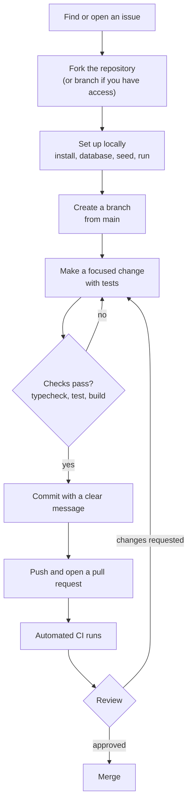
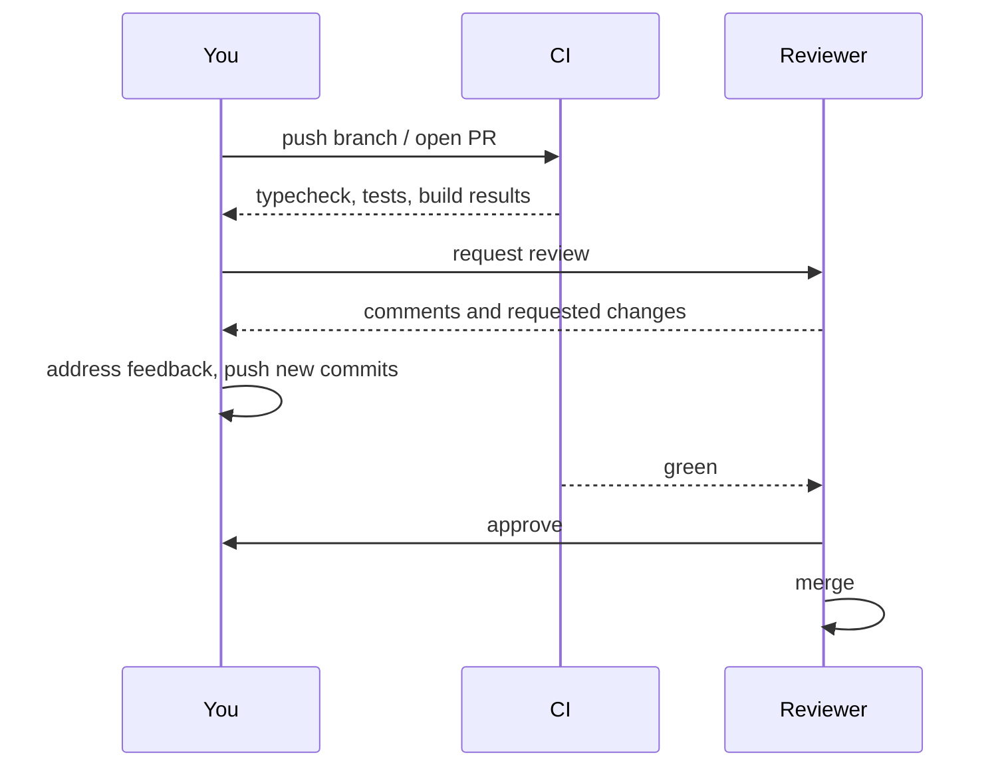

# Contributing to Pyxis

Thank you for helping. This guide walks you from "I want to help" to a merged change, step by step. It is written for people who have never seen the codebase. If something here is unclear or wrong, fixing this file is a valid first contribution. By taking part you agree to follow the [Code of Conduct](CODE_OF_CONDUCT.md).

## Contents

1. [Before you start](#1-before-you-start)
2. [The workflow at a glance](#2-the-workflow-at-a-glance)
3. [Set up your environment](#3-set-up-your-environment)
4. [Find something to work on](#4-find-something-to-work-on)
5. [Create a branch](#5-create-a-branch)
6. [Make your change](#6-make-your-change)
7. [Check your work](#7-check-your-work)
8. [Commit](#8-commit)
9. [Open a pull request](#9-open-a-pull-request)
10. [Review and merge](#10-review-and-merge)
11. [Rules for specific kinds of change](#11-rules-for-specific-kinds-of-change)
12. [Security issues](#12-security-issues)
13. [Working with AI assistants](#13-working-with-ai-assistants)
14. [Community expectations](#14-community-expectations)
15. [Quick checklist](#15-quick-checklist)

## 1. Before you start

Read these four files. They are short and they decide what is acceptable.

| File | Why it matters |
|---|---|
| [PRODUCT.md](PRODUCT.md) | Who the product is for and the hard constraints: metrics only, no personal data, no claims of adoption, uptime or compliance. A change that breaks a constraint will not be merged. |
| [README.md](README.md) | What exists, what is real, how to run it. |
| [TECHNICAL.md](TECHNICAL.md) | How it works: request flows, the data model, tenant isolation. Read the security section before touching anything under `src/server`, `src/app/v1` or `db/`. |
| [AGENTS.md](AGENTS.md) | **Next.js 16 in this repo has breaking changes** compared with the versions most tutorials and models know. Before writing framework code (routes, layouts, config), read the matching guide in `node_modules/next/dist/docs/`. |

Three rules sit above everything else:

1. **Privacy by omission.** Never store or log wallet addresses, signatures, transaction XDR, IP addresses, request bodies, traces or logs in analytics data.
2. **The tenant comes from the credential, never from the payload.** Do not read a project or tenant id from request data.
3. **Honest numbers.** If a metric is approximate or frontend-reported, the UI says so. Do not describe wallet events as "confirmed".

## 2. The workflow at a glance



## 3. Set up your environment

**Prerequisites:** Node.js 22 (the version CI uses), npm, and git. Docker is optional because an embedded PostgreSQL is provided. You do not need a Stellar wallet to work on most of the code; you need one only to try the real sign-in flow (a testnet wallet such as Freighter).

1. **Fork and clone**
   ```bash
   git clone https://github.com/<your-account>/pyxis.git
   cd pyxis
   git remote add upstream <maintainers' repository URL>
   ```
2. **Install dependencies.** The legacy flag is required.
   ```bash
   npm install --legacy-peer-deps
   ```
3. **Start the database** (leave it running in its own terminal):
   ```bash
   npm run db:dev
   ```
   This starts a real PostgreSQL on port 54329 and applies the migrations. Data lives in `.pyxis-data/`, which is git-ignored. Stop it with Ctrl+C.
4. **Load synthetic demo data** and note the ingest keys it prints:
   ```bash
   npm run seed
   ```
5. **Run the app.** To get the operator view, add your own testnet Stellar public key:
   ```bash
   OPERATOR_ACCOUNTS=G...YOURKEY npm run dev
   ```
   On Windows PowerShell set the variable first: `$env:OPERATOR_ACCOUNTS="G..."; npm run dev`.
6. **Confirm everything works:** open <http://localhost:3000>, and run `npm test` in another terminal.

**Optional: use a deployed backend with your local UI.** Put `BACKEND_URL=https://<deployment>` in `.env.local`. Never commit `.env*` files; they are git-ignored.

**Troubleshooting**

| Symptom | Likely cause and fix |
|---|---|
| `{"code":"service_unavailable", ...}` on sign-in | The database is not running. Start `npm run db:dev`. |
| `npm install` fails on peer dependencies | Use `--legacy-peer-deps`. |
| Port 3000 already in use | Another dev server is running; stop it or run `npx next dev -p 3100`. |
| A tracked file such as `tsconfig.json` changes after `next dev` | Next.js rewrites its generated type includes. Review the diff and keep only intentional changes. |
| Test teardown error `EBUSY ... pyxis-pg-...` on Windows | A temp-directory lock when the embedded PostgreSQL shuts down. Tests that ran have already passed; rerun if in doubt. |

## 4. Find something to work on

- Look for open issues labelled `good first issue` or `help wanted`. If you want to work on something not listed, **open an issue first** and describe the problem and your proposed approach, so we can agree before you spend time.
- Good starting points that are known and unfinished (each is described in the README's "Known gaps" and in [docs/sdk-build-spec.md](docs/sdk-build-spec.md)):

| Area | Idea | Difficulty |
|---|---|---|
| Docs | Fix an unclear step, add a missing example, correct a stale table | Easy |
| Server | Make wallet-event ingestion update the API key's last-used time and write an ingestion audit row | Small |
| Server | Rate limiting for `/v1/*` | Medium |
| Tests | Add a failing-then-passing test for an uncovered branch in `src/server` | Easy to medium |
| SDK | Build the public wallet-funnel SDK from [docs/sdk-build-spec.md](docs/sdk-build-spec.md) | Large |
| UI | Capture the states not yet reviewed (sign-in, mobile drawer, keyboard focus) and fix what you find | Medium |

Comment on the issue that you are taking it so two people do not duplicate work.

## 5. Create a branch

Always branch from an up-to-date `main`.

```bash
git fetch upstream
git switch main
git merge --ff-only upstream/main
git switch -c <type>/<short-description>
```

Branch names use a type prefix: `feat/`, `fix/`, `docs/`, `test/`, `refactor/`, `chore/`. Examples: `fix/wallet-last-used`, `docs/readme-quickstart`. Keep one concern per branch; unrelated fixes go in their own branch and pull request.

## 6. Make your change

### Project map (where things live)

| You want to change | Look in |
|---|---|
| A page or screen | `src/app/...` and shared pieces in `src/components/pyxis/` |
| A session API endpoint (used by the dashboards) | `src/app/api/v1/...` |
| The ingest endpoints (`/v1/metrics`, `/v1/wallet-events`) | `src/app/v1/...` and parsing in `src/server/ingest/`, `src/server/wallet-events.ts` |
| Database schema or security policies | `db/migrations/` |
| Auth, keys, queries, Umami, domain verification | `src/server/` |
| The browser data layer | `src/lib/api.ts` (RTK Query) |
| The wallet-funnel SDK | `sdk/wallets-kit/` |

### Code standards

- **TypeScript, strict.** No `any` unless unavoidable and commented. `npm run typecheck` must pass.
- **Validate every external input** with `zod` (see existing routes) and reject unknown or oversized data. Authenticate before reading a request body on ingest routes.
- **All tenant data goes through `withContext`** (`src/server/db.ts`), which sets the project and operator context for row-level security inside a transaction. Never query tenant tables with the bare pool.
- **Authorize every route** with `authorize(user, projectId, minRole)` and return `404 not_found` (not `403`) for a project the user cannot see.
- **Keep server code out of client bundles.** Anything under `src/server` is for route handlers only.
- **Error messages are generic and safe.** Do not echo secrets, tokens or internal details.
- **Do not add dependencies lightly.** Prefer the platform and existing libraries. Explain any new dependency in the pull request.
- **Comments explain why, not what.** Match the surrounding style.

### Tests are part of the change

| If you change | Add or update |
|---|---|
| Route normalization, histograms, OTLP parsing, key format | `tests/unit.test.ts` |
| Tenant isolation, roles, key lifecycle, SQL | `tests/db.test.ts` (runs against a real PostgreSQL) |
| Wallet events or the SDK | `tests/wallet.test.ts` |
| Domain verification, the SSRF guard, Umami | `tests/web.test.ts` |
| A bug | A test that fails before your fix and passes after |

Any change that touches data access needs a **cross-tenant negative test**: prove a user or key from project A cannot read or write project B.

## 7. Check your work

Run all three before you push. CI runs the same commands.

```bash
npm run typecheck
npm test
npm run build
```

For UI changes, also run the app and look at it: the desktop dashboard, a narrow (phone) width, the empty and error states, and keyboard focus. If you have the repository's design tooling installed, run `.claude/skills/impeccable/scripts/impeccable detect --json src/app src/components` and fix every non-advisory finding. Attach screenshots to the pull request.

## 8. Commit

Make small, focused commits. This project uses [Conventional Commits](https://www.conventionalcommits.org) style (a proposed convention; the history so far is short):

```text
<type>(<scope>): <summary in the imperative, under 72 characters>

Why this change is needed and what it does. Wrap at about 72 characters.
Reference issues like: Fixes #123
```

Types: `feat`, `fix`, `docs`, `test`, `refactor`, `perf`, `chore`, `ci`. Examples:

- `fix(wallet): update key last-used time on wallet-event ingest`
- `docs(readme): document BACKEND_URL for local UI development`

Never commit secrets, ingest keys, `.env*` files, wallet keys, or local data such as `.pyxis-data/`.

## 9. Open a pull request

1. Push your branch to your fork: `git push -u origin <branch>`.
2. Open a pull request against `main`. Describe it using this template:

   ```markdown
   ## What and why
   (the problem, and how this change solves it)

   ## How I tested it
   (commands run, manual steps, screenshots for UI changes)

   ## Checklist
   - [ ] typecheck, tests and build pass locally
   - [ ] tests added or updated (including a cross-tenant test if data access changed)
   - [ ] docs updated (README, TECHNICAL, comments) where behavior changed
   - [ ] no secrets, no personal data, no new tracking
   - [ ] UI: checked desktop and narrow widths, empty and error states, keyboard focus
   - [ ] no claims of adoption, uptime or compliance
   ```
3. Keep the pull request small enough to review in one sitting. If it grows, split it.
4. Link the issue it resolves.

## 10. Review and merge



- A maintainer reviews for correctness, tenant safety, privacy, tests and clarity. Expect questions; they are not criticism.
- Push follow-up commits to the same branch; do not open a new pull request.
- CI must be green. If a failure looks unrelated to your change, say so in a comment.
- Pull requests are expected to be squash-merged (a proposed convention, to be confirmed by the maintainers), so the pull request title becomes the commit message. Keep it in the Conventional Commits form.
- After merge, delete your branch and sync your fork.

## 11. Rules for specific kinds of change

### Database migrations

- Migrations are SQL files in `db/migrations/`, applied in filename order, each inside a transaction, with a stored checksum.
- **Never edit a migration that has been applied or merged.** The runner stops with "Migration ... was modified after being applied". Add a new file instead, for example `002_add_thing.sql`.
- Every new tenant-owned table needs a `project_id` column, row-level security enabled and **forced**, and a `tenant_all` policy like the existing tables. Grant the runtime role `pyxis_app` only the privileges it needs.
- Test it: extend `tests/db.test.ts` with a cross-tenant negative test.

### Ingest endpoints (`/v1/*`)

- Authenticate first, then read the body. Enforce size and count limits. Keep the strict allowlist for wallet events: an unknown property rejects the event.
- Never read a tenant from the payload.
- Changing what the server accepts changes the public contract. Update [TECHNICAL.md](TECHNICAL.md), [docs/sdk-build-spec.md](docs/sdk-build-spec.md) and the tests together.

### UI

- Follow [DESIGN.md](DESIGN.md): dark-first, one violet accent used only for action, selection, focus and the live series; red only for 5xx and failure; figures in Geist Mono; hairlines instead of shadows; definitions beside numbers.
- Reuse components in `src/components/pyxis/` and `src/components/ui/`. Do not nest panels, add decorative gradients, or invent new colors.
- Every screen needs loading, empty, error and keyboard-focus states, and must work on a phone width.
- Respect `prefers-reduced-motion`.
- If you introduce a durable visual change, update `DESIGN.md` in the same pull request.

### Copy and documentation

- Say "reported by the frontend", not "confirmed", for wallet events.
- Do not add testimonials, customer logos, or uptime or compliance claims.
- Use plain language, short sentences, and tables for reference material.

### Dependencies and security

- Run `npm install --legacy-peer-deps` and commit the lockfile change.
- Do not add a dependency that phones home, loads third-party scripts into the app, or collects data.

## 12. Security issues

**Do not open a public issue for a vulnerability.** Follow [SECURITY.md](SECURITY.md): it explains how to report privately, what is in scope, how severity is judged, the rules for testing, and which weaknesses are already known.

If you change code that touches authentication, keys, tenant isolation, ingest validation or domain verification, read [SECURITY.md](SECURITY.md) section 14 first and make sure your change keeps every control in its section 8.

## 13. Working with AI assistants

AI assistants are welcome for drafting, but **you are responsible for what you submit**. Read and understand every line. Run the checks yourself. Do not paste secrets or private data into a prompt. This repository includes agent and skill definitions (`.claude/`, `.github/`) used for design review; if you use them, follow the same rules in this guide and still read `AGENTS.md` before writing Next.js code.

## 14. Community expectations

- Be kind, specific and patient. Assume good intent; critique code, not people.
- Keep discussion on the issue or pull request so others can follow it.
- Credit others' work. By contributing you agree your work is licensed under the Apache License 2.0 (see `LICENSE`). Do not copy code you cannot license that way, and do not add third-party code with incompatible terms.
- If someone is behaving badly, tell a maintainer privately.

## 15. Quick checklist

Before you ask for review:

- [ ] I read PRODUCT.md and the relevant part of TECHNICAL.md
- [ ] My branch is from the latest `main` and has one concern
- [ ] `npm run typecheck`, `npm test` and `npm run build` pass
- [ ] I added or updated tests, including a cross-tenant test if I touched data access
- [ ] I updated the docs that my change affects
- [ ] I checked the UI on desktop and a narrow width, with keyboard focus and empty and error states
- [ ] I did not add secrets, personal data, tracking or unsupported claims
- [ ] My pull request describes what, why and how I tested it
