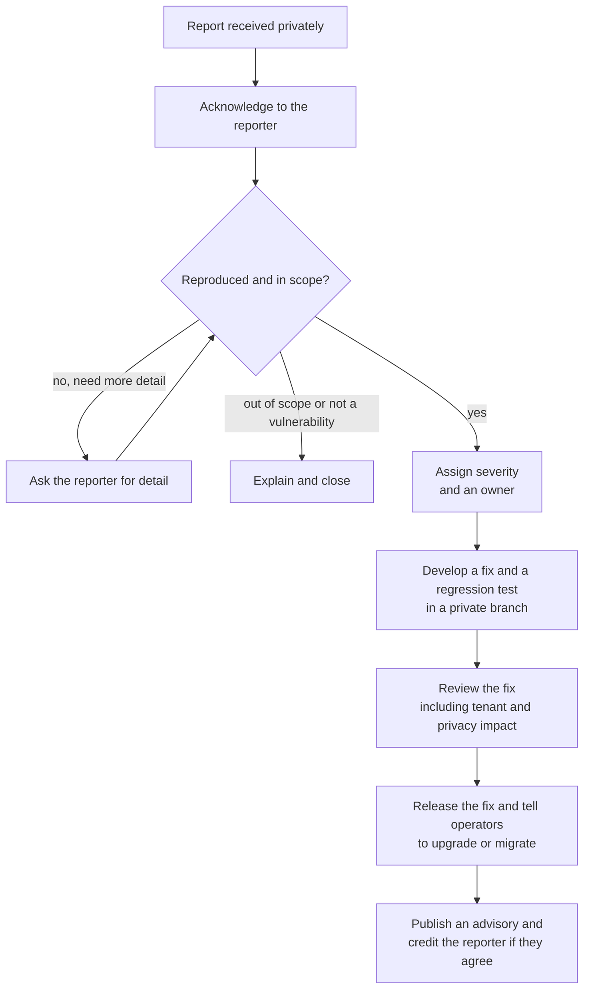
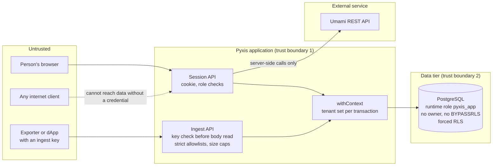
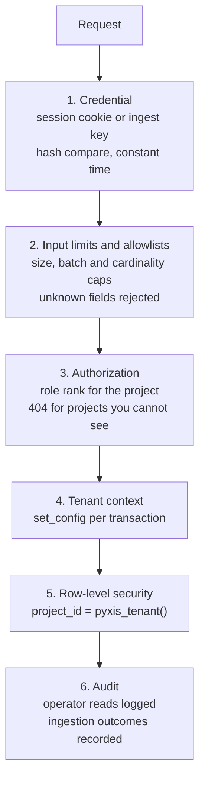
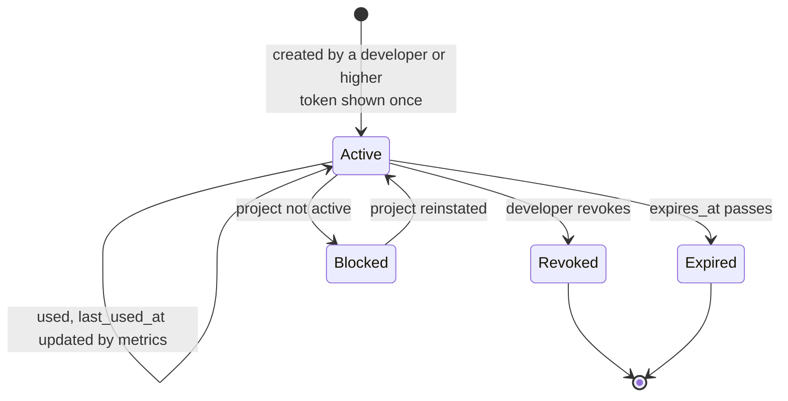

# Security policy

This document explains how to report a vulnerability in Pyxis, what is in scope, how the system is defended, and where it is known to be weak. It is written for three readers: **security researchers** who want to report an issue, **operators** who deploy Pyxis, and **contributors** who change code that touches security.

Pyxis is a **testnet MVP**. Nothing here is a certification, an audit result or a compliance claim. No third-party security audit has been performed. Where this document says "intended" or "proposed", it describes a process the maintainers should confirm, not something already guaranteed.

## Contents

1. [Reporting a vulnerability](#1-reporting-a-vulnerability)
2. [What happens after you report](#2-what-happens-after-you-report)
3. [Scope](#3-scope)
4. [Severity guide](#4-severity-guide)
5. [Rules for testing](#5-rules-for-testing)
6. [Supported versions](#6-supported-versions)
7. [Security model](#7-security-model)
8. [Controls and where they live](#8-controls-and-where-they-live)
9. [Data classification](#9-data-classification)
10. [Secrets and cryptography](#10-secrets-and-cryptography)
11. [Threat model](#11-threat-model)
12. [Known weaknesses and hardening backlog](#12-known-weaknesses-and-hardening-backlog)
13. [Deployment hardening checklist](#13-deployment-hardening-checklist)
14. [For contributors](#14-for-contributors)
15. [Acknowledgements](#15-acknowledgements)

## 1. Reporting a vulnerability

**Do not open a public issue, pull request or discussion for a security problem.** Public details put every deployment at risk before a fix exists.

**How:** use GitHub's private vulnerability reporting. Open the repository's **Security** tab and choose **Report a vulnerability**, or go directly to <https://github.com/Pyxis-Hq/pyxis/security/advisories/new>. Only the maintainers can see the report.

Include, as far as you can:

| Item | Why we need it |
|---|---|
| A short description and the affected component or file | To route the report |
| Steps to reproduce, ideally a minimal request or script | To confirm it quickly |
| The impact you believe it has (what an attacker gains) | To set severity |
| The version or commit you tested and the environment (local, testnet deployment) | To find the cause |
| Whether you have shared it with anyone else | To coordinate disclosure |
| How you would like to be credited, or that you want to stay anonymous | To acknowledge you correctly |

Please do not include real wallet secrets, real user data or production credentials in a report.

## 2. What happens after you report

Proposed handling targets (to be confirmed by the maintainers; none of these is a guarantee, and the product makes no service-level claim):

| Stage | Target |
|---|---|
| Acknowledge the report | within 3 business days |
| First assessment (reproduced, severity, in or out of scope) | within 10 business days |
| Fix for a critical or high issue | as soon as practical; operators are told before details are public |
| Public advisory | after a fix is available, or at an agreed date |

We ask for **coordinated disclosure**: please give us a reasonable time to fix before publishing, and we will keep you informed. If a fix is taking too long, tell us and we will agree a date together.

Good-faith research that follows section 5 is welcome. The maintainers should state their legal safe-harbor position here once agreed; this document does not grant legal protection on its own.

## 3. Scope

| In scope | Out of scope |
|---|---|
| The application in this repository (`src/`) | A third party's deployment configuration that is not caused by this code |
| Database schema, policies and functions (`db/migrations/`) | Vulnerabilities in Umami itself (report to the Umami project), PostgreSQL, Next.js or other dependencies, unless Pyxis uses them unsafely |
| The ingest endpoints `/v1/metrics` and `/v1/wallet-events` | Denial of service by sheer traffic volume, and the known absence of rate limiting (see section 12) |
| The session API under `/api/v1` | Social engineering, phishing, physical access |
| Sign-in and session handling | Reports that only say a security header is missing without a demonstrated impact |
| API key generation, storage and revocation | Stellar network, wallet software or SDK vulnerabilities (report to their maintainers) |
| Domain verification and the Umami integration | Findings that need a compromised operator or database owner account |
| The alpha wallet SDK in `sdk/` | Issues in demo or seeded synthetic data |
| Build and deploy configuration files in this repo | Spam, or testnet-only value loss with no impact on Pyxis |

The highest-value findings are anything that **crosses a tenant boundary**, leaks an **ingest key or session**, bypasses the **wallet-event allowlist**, enables **SSRF** through domain verification, makes Pyxis **store personal data**, or escalates a role (for example to operator).

## 4. Severity guide

| Severity | Typical examples |
|---|---|
| Critical | Read or write another project's data without credentials; obtain operator access; extract stored secrets; remote code execution |
| High | A viewer or developer performing admin actions; a key or session that survives revocation or logout; SSRF reaching internal addresses; persistent storage of addresses, signatures or other personal data |
| Medium | Information disclosure across roles inside one project; bypass of an ingest limit that enables resource exhaustion; missing authorization on a low-impact route; stored XSS needing user interaction |
| Low | Generic error detail that aids reconnaissance; hardening gaps with no demonstrated exploit; weak defaults documented as deployer responsibility |

Severity depends on impact and exploitability; we will explain our reasoning.

## 5. Rules for testing

| Do | Do not |
|---|---|
| Test against your own local instance (`npm run db:dev`, `npm run seed`, `npm run dev`) or a testnet deployment you were given permission to test | Test against a deployment you do not have permission for |
| Use synthetic data and throwaway testnet accounts | Use real wallet secrets, mainnet funds or real user data |
| Stop as soon as you have shown the issue exists | Download, modify or delete data that is not yours; pivot to other systems |
| Keep proof-of-concept requests small | Run denial-of-service, load or brute-force campaigns |
| Report what you find promptly and privately | Publish details before a fix is agreed |

## 6. Supported versions

| Version | Supported |
|---|---|
| `main` branch (testnet MVP, `0.1.0`) | Yes; fixes land here |
| Older commits, forks and unmaintained deployments | No |

There are no tagged releases or long-term support branches yet. Operators should deploy from `main` and apply migrations in order (see [TECHNICAL.md](TECHNICAL.md), section 7).

## 7. Security model

Pyxis has two principals and two credentials that never mix: a **person**, authenticated by a Stellar wallet signature and a session cookie, and a **machine or browser app**, authenticated by an ingest key. Isolation between projects is enforced three times: by the credential, by application authorization, and by PostgreSQL row-level security.

The layers, in the order a request meets them:

## 8. Controls and where they live

| Area | Control | Code or file |
|---|---|---|
| Authentication | Sign-in by Ed25519 signature over a server challenge; single-use nonce, 5-minute expiry; signed payload is SHA-256 of `"Stellar Signed Message:\n"` plus the message | `src/server/auth/session.ts`, `src/app/api/v1/auth/` |
| Sessions | 32 random bytes; only the SHA-256 hash is stored; httpOnly, SameSite=Lax cookie, `Secure` in production; 7-day expiry; logout deletes the server-side session | `src/server/auth/session.ts`, `auth/verify`, `auth/logout` |
| Ingest keys | `pyx_live_<16 hex>.<43 base64url>`; 32-byte random secret; only SHA-256 stored; constant-time comparison; revoke, expiry, scope and project-status checks; token shown once | `src/server/keys.ts` |
| Authorization | Role ranks viewer 1 to owner 5; `authorize()` on every project route; unknown or forbidden projects return 404 | `src/server/auth/session.ts` |
| Tenant isolation | Tenant from the credential only; row-level security enabled and forced on tenant tables; non-owner runtime role without `BYPASSRLS`; transaction-local context | `db/migrations/001_init.sql`, `src/server/db.ts` |
| Pre-tenant lookups | `SECURITY DEFINER` functions with a fixed `search_path`, execute revoked from `PUBLIC` and granted to the runtime role | `db/migrations/001_init.sql` |
| Input validation | `zod` on route bodies; strict allowlist for wallet events (unknown property rejects the event); OTLP attribute allowlist | route handlers, `src/server/wallet-events.ts`, `src/server/ingest/otlp.ts` |
| Resource limits | Metrics body 1 MB and 5,000 data points; wallet request 20,000 characters and 50 events; 10 services per project; 200 routes per service; 90-day query range | `src/server/ingest/otlp.ts`, `wallet-events.ts`, `queries.ts` |
| Authentication before parsing | Ingest routes authenticate before reading the body | `src/app/v1/*/route.ts` |
| SSRF protection | Domain verification resolves the host and refuses private, loopback, link-local, CGNAT and multicast addresses; no redirects; 5-second timeout; 512-byte read | `src/server/domain.ts` |
| Operator accountability | Aggregates only; every overview, project view and status change inserts an `operator_audit_events` row in the same transaction | `src/app/api/v1/operator/`, `analytics/route.ts` |
| SQL safety | Parameterized queries throughout; a test confirms injection strings stay data | `tests/db.test.ts` |
| Safe errors | Generic messages and machine codes; no secrets in responses | `src/server/api.ts`, route handlers |
| Privacy by omission | No IPs, bodies, traces, logs, addresses, signatures or XDR are stored | ingest validators, `traces` and `logs` routes return 404 |
| Migrations | Checksummed and transactional; a modified applied file aborts the run | `scripts/migrate.ts` |

## 9. Data classification

| Data | Class | Stored? | Notes |
|---|---|---|---|
| Per-route request counts and latency histograms | Operational aggregate | Yes | Per minute, per project |
| Wallet event counts (event, provider category, network) | Operational aggregate | Yes | Frontend-reported; no identifiers |
| Project name and description | Customer-provided | Yes | Visible to project members |
| Member Stellar public keys | Pseudonymous identifier | Yes | Needed for access control; public keys are not secrets |
| Ingest key secrets | Secret | **Hash only** | Shown once at creation |
| Session tokens | Secret | **Hash only** | Cookie holds the token |
| Sign-in nonces | Short-lived | Yes | Single use, 5-minute expiry, not yet purged |
| Domain names and verification tokens | Customer-provided | Yes | The token proves domain control only when published |
| Website visitor statistics | Aggregates from Umami | In Umami | Umami's own data handling applies |
| IP addresses, request or response bodies, query strings | Personal or sensitive | **No** | Never read by Pyxis |
| Traces and logs | Sensitive | **No** | Rejected (`404 signal_not_supported`) |
| Wallet addresses, signatures, transaction XDR in analytics | Sensitive | **No** | Allowlist rejects them |

## 10. Secrets and cryptography

| Secret or primitive | Purpose | Handling |
|---|---|---|
| Ingest key secret | Authenticates `/v1/*` | 256 bits from a CSPRNG; SHA-256 stored; compared in constant time; never logged; replace rather than recover |
| Session token | Authenticates the dashboards | 256 bits from a CSPRNG; SHA-256 stored; httpOnly cookie |
| Sign-in nonce | Binds a signature to one attempt | 192 bits; single use; 5-minute expiry |
| Stellar signature | Proves control of an account | Ed25519 via `@stellar/stellar-sdk`, over a domain-separated SHA-256 hash |
| `DATABASE_URL`, `ADMIN_DATABASE_URL`, `PYXIS_APP_PASSWORD` | Database access | Environment variables only; never commit `.env*` (git-ignored) |
| `UMAMI_USER`, `UMAMI_PASSWORD` | Umami REST access | Environment variables; used server-side only |
| `OPERATOR_ACCOUNTS` | Operator role grants | Environment variable listing public keys |

A fast hash is appropriate for key and session secrets because they are 256-bit random values, not human passwords. There is no encryption at rest in the application layer; rely on your database and disk encryption. TLS termination is the deployer's responsibility (the session cookie is `Secure` only when `NODE_ENV=production`).

The ingest key lifecycle:

## 11. Threat model

| # | Threat | Mitigation | Residual risk |
|---|---|---|---|
| T1 | A user reads or writes another project's data | Credential-derived tenant, `authorize`, forced RLS under a non-owner role, negative tests | A new table added without a policy |
| T2 | An attacker forges the tenant in a payload | Tenant attributes are never read from payloads; tested | None known |
| T3 | An ingest key is stolen | Hash-only storage, scopes, immediate revocation, expiry | Browser keys are public by nature; use dedicated ingest-only keys |
| T4 | Brute force of keys or sessions | 256-bit secrets, generic errors | **No rate limiting** (section 12) |
| T5 | Replay or forgery of sign-in | Single-use nonce, expiry, signature bound to account and nonce | Expired challenge rows are not purged |
| T6 | Session theft or fixation | httpOnly, SameSite=Lax, Secure in production, hashed storage, server-side logout | No CSRF token; relies on SameSite; no re-authentication for sensitive actions |
| T7 | SSRF via domain verification | Public-address check, no redirects, timeout, size cap | DNS rebinding between lookup and fetch |
| T8 | Collection of personal data | Allowlists, rejected properties, aggregates only | Umami's behavior for web analytics |
| T9 | Privilege escalation to operator | Operator derived from `OPERATOR_ACCOUNTS`; operator routes check the flag; every action audited | A removed operator keeps the flag until their next sign-in (section 12) |
| T10 | Resource exhaustion | Body, point, batch, cardinality and range caps | No rate limiting or per-project quotas |
| T11 | Injection (SQL, XSS) | Parameterized SQL; React escapes output; no `dangerouslySetInnerHTML` of user input found in the UI | No Content Security Policy as a second layer |
| T12 | Supply-chain compromise | Lockfile, small dependency set, no third-party scripts loaded into the app | No automated dependency or secret scanning in CI |
| T13 | A compromised operator or database owner | Aggregate-only operator API, audit log | Out of the threat model: these accounts are trusted by configuration |

## 12. Known weaknesses and hardening backlog

These are **known and unfixed**. They are disclosed so operators can mitigate them and researchers do not spend time rediscovering them. Reports of these items alone are not treated as new vulnerabilities, but a demonstrated exploit that goes beyond the description is welcome.

| Item | Detail | Mitigation today | Fix direction |
|---|---|---|---|
| No rate limiting on `/v1/*` or sign-in | Only size and count caps apply | Run behind a proxy or WAF with limits | Per-key and per-IP limits |
| No HTTP security headers | No CSP, `X-Frame-Options`, HSTS or Referrer-Policy is set by the app | Set them at the proxy | Add headers in `next.config.ts` and a strict CSP |
| Stale operator rights | The operator flag is refreshed only when a person signs in, so removing an account from `OPERATOR_ACCOUNTS` takes effect at their next sign-in, not immediately (sessions last 7 days) | Revoke by deleting their rows in `sessions`, or remove the account then rotate | Evaluate `OPERATOR_ACCOUNTS` per request |
| Default credentials in shipped files | Migration 001 creates `pyxis_app` with password `pyxis_app`; `docker-compose.yml` uses `postgres/postgres`, `umami/umami` and `APP_SECRET: change-me-in-real-deployments`; code falls back to a local `pyxis_app` URL when `DATABASE_URL` is unset | Run `npm run db:role` with a strong `PYXIS_APP_PASSWORD`; never use the compose file as-is in production | Require secrets at startup; remove fallbacks |
| Members added without consent | An admin can add any Stellar key; the person gains access when they next sign in | Review the team list | Invitation acceptance |
| Wallet-event route bookkeeping | Does not update a key's `last_used_at` and writes no `ingestion_audit` row, so key misuse via this route is harder to spot | Monitor out of band | Mirror the metrics route |
| Unpurged tables | `auth_challenges` and expired `sessions` accumulate | Periodic manual cleanup | Scheduled job |
| No CSRF token | Protection relies on SameSite=Lax cookies | Keep deployments on HTTPS and modern browsers | Origin checks on mutating routes |
| Server error logging | The sign-in challenge route logs the caught error object with `console.error` | Restrict log access | Log a sanitized code |
| No automated dependency, secret or SAST scanning in CI | CI runs typecheck, tests and build only | Run `npm audit` and a secret scanner locally | Add scanners to CI |
| No third-party security audit; no SBOM or signed releases | Unreviewed beyond the project's own tests | Treat as testnet software | Commission an audit before mainnet use |
| Umami integration untested against a real release; compose pins `latest` | Behavior and upgrade risk unverified | Pin Umami by digest in your deployment | Clean-room run and pinning |
| No backup or restore procedure | Data loss risk | Use your platform's database backups | Document and rehearse restore |

## 13. Deployment hardening checklist

| Done | Item |
|---|---|
| [ ] | Serve everything over HTTPS only; confirm the session cookie has the `Secure` flag |
| [ ] | Set `PYXIS_APP_PASSWORD` to a long random value, run `npm run db:role`, and point `DATABASE_URL` at `pyxis_app` |
| [ ] | Never expose the database port publicly; use a private network |
| [ ] | Keep `ADMIN_DATABASE_URL` (owner) out of the running app; use it only for migrations |
| [ ] | Replace every default credential in `docker-compose.yml` if you use it; do not run it as-is on the internet |
| [ ] | Set `OPERATOR_ACCOUNTS` to the smallest possible list; remember removals apply at next sign-in |
| [ ] | Add rate limiting and security headers at the proxy or CDN |
| [ ] | Pin Umami by image digest and keep it patched; give Pyxis a dedicated Umami account |
| [ ] | Store secrets in your platform's secret manager; never commit `.env*` files |
| [ ] | Use dedicated, ingest-only keys for browser apps; revoke them when no longer needed |
| [ ] | Enable database backups and test a restore |
| [ ] | Run `npm audit` and a secret scanner; keep dependencies updated |
| [ ] | Restrict who can read application logs |
| [ ] | Review `operator_audit_events` and `ingestion_audit` periodically |

## 14. For contributors

| When you change | Security expectation |
|---|---|
| Any tenant table or query | Use `withContext`; add or keep row-level security with a `tenant_all` policy; add a cross-tenant negative test |
| A route | Authorize with the minimum role; return 404 for projects the caller cannot see; validate with `zod`; return generic errors |
| An ingest endpoint | Authenticate before reading the body; enforce size, count and allowlist rules; never read a tenant from the payload |
| Anything that fetches a URL | Apply the SSRF rules in `src/server/domain.ts`; no redirects; resolve and check addresses |
| Secrets, keys, sessions | Hash at rest; compare in constant time; never log; never return after creation |
| Dependencies | Justify additions; prefer none; no packages that load remote scripts or collect data |
| Logging | Never log keys, tokens, signatures, addresses or request bodies |
| UI | Do not render user-supplied HTML; keep copy honest about what data is collected |

Follow [CONTRIBUTING.md](CONTRIBUTING.md) for the process and [TECHNICAL.md](TECHNICAL.md), sections 6 and 17, for the design. A pull request that weakens a control in section 8 needs an explicit justification and a maintainer's agreement.

## 15. Acknowledgements

We will credit reporters who want credit once a fix is public. No acknowledgements are listed yet.
