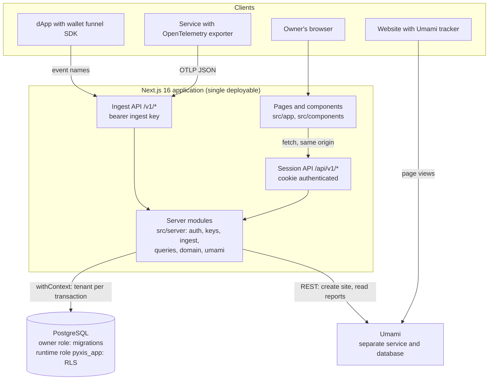
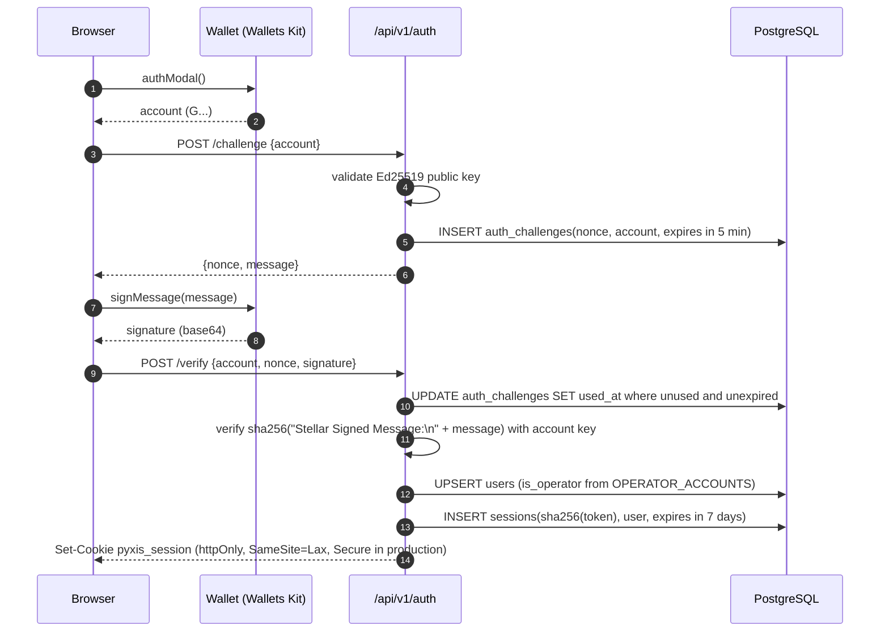
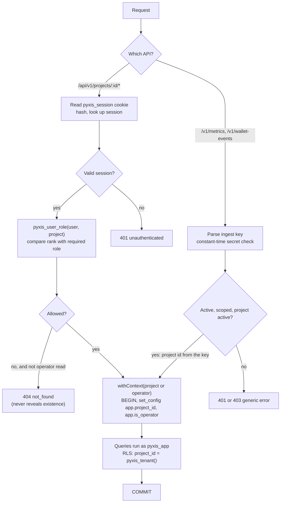
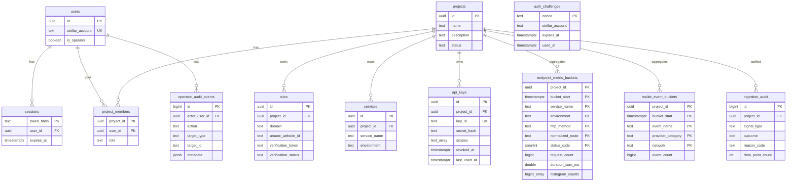
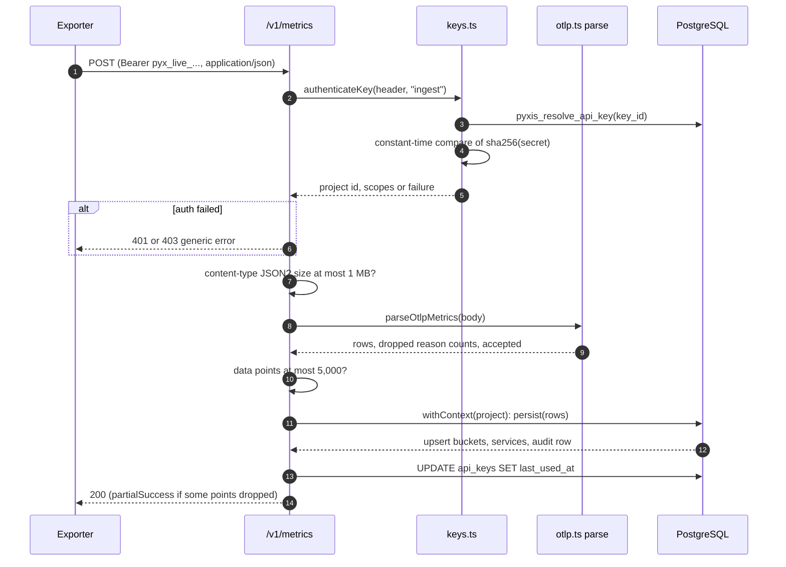
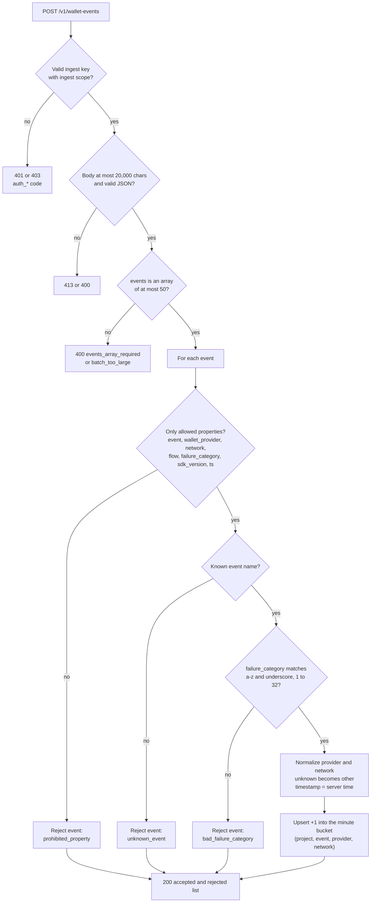
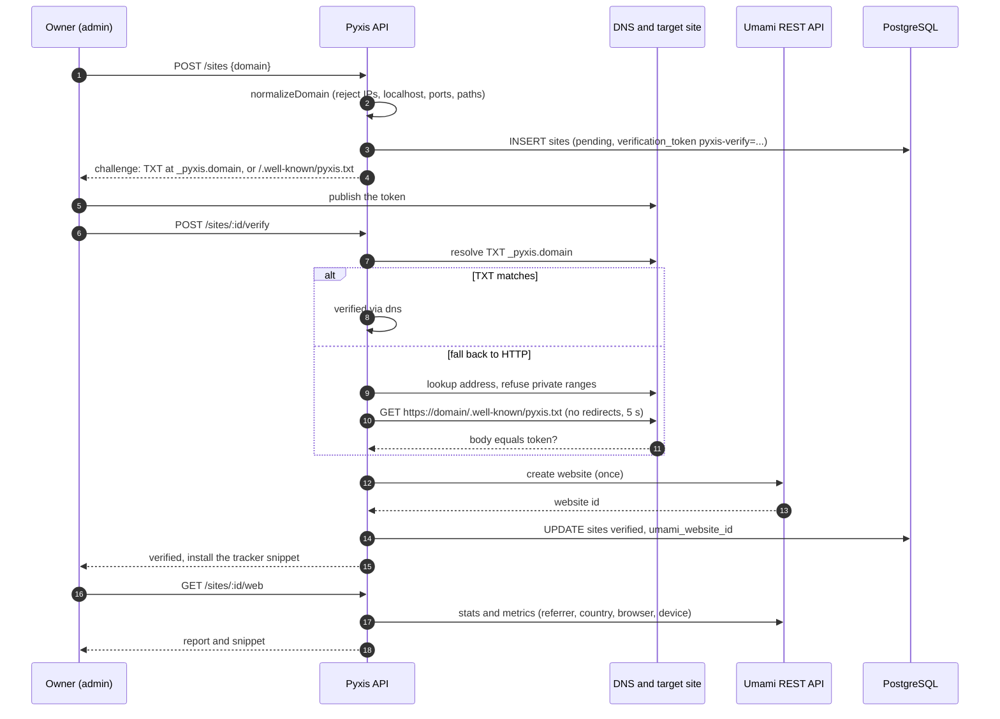
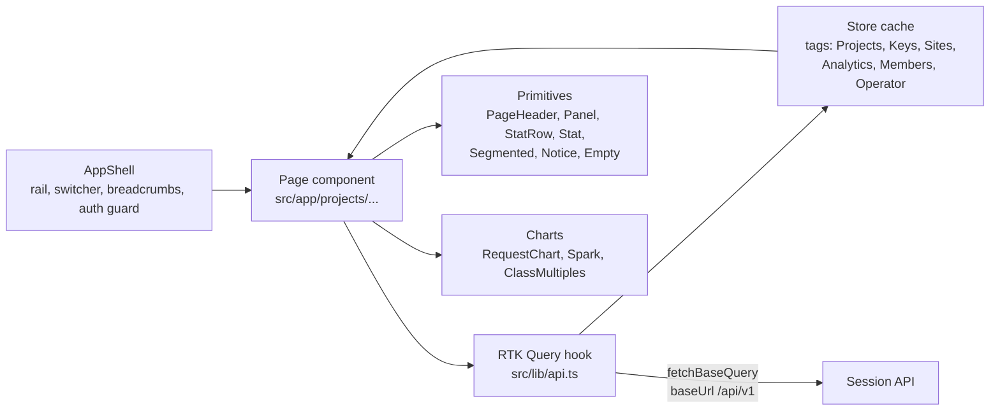
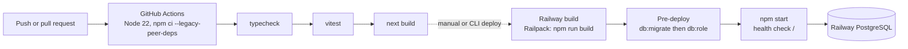

# Pyxis: technical documentation

How the system works, for engineers who will read, change or operate it. Everything here was written from the source in this repository; file paths are given so each statement can be checked. For setup see [README.md](README.md), for the contribution process see [CONTRIBUTING.md](CONTRIBUTING.md), for product constraints see [PRODUCT.md](PRODUCT.md).

## Contents

1. [Scope and goals](#1-scope-and-goals)
2. [System architecture](#2-system-architecture)
3. [Technology stack](#3-technology-stack)
4. [Repository map](#4-repository-map)
5. [Authentication and sessions](#5-authentication-and-sessions)
6. [Authorization and tenant isolation](#6-authorization-and-tenant-isolation)
7. [Data model](#7-data-model)
8. [API metrics ingestion](#8-api-metrics-ingestion)
9. [Wallet-event ingestion](#9-wallet-event-ingestion)
10. [Web analytics and domain verification](#10-web-analytics-and-domain-verification)
11. [Querying and the dashboards](#11-querying-and-the-dashboards)
12. [API reference](#12-api-reference)
13. [Frontend architecture](#13-frontend-architecture)
14. [Configuration](#14-configuration)
15. [Build, CI and deployment](#15-build-ci-and-deployment)
16. [Testing](#16-testing)
17. [Security design](#17-security-design)
18. [Design decisions](#18-design-decisions)
19. [Known limitations and technical debt](#19-known-limitations-and-technical-debt)
20. [Glossary](#20-glossary)

## 1. Scope and goals

Pyxis gives Stellar projects API metrics, web analytics and a wallet funnel from one shared, multi-tenant service. The system is built around four constraints that drive most design choices.

| Constraint | Consequence in the design |
|---|---|
| Store aggregates only; never personal data | Per-minute counters and fixed-boundary histograms; strict allowlists; no IPs, bodies, traces, logs, addresses, signatures or XDR |
| Strict tenant isolation | The tenant comes from the credential, and PostgreSQL row-level security enforces it for a non-owner runtime role |
| Comparable, honest metrics | One canonical metric (HTTP server duration histogram), one fixed bucket set, percentiles labelled as approximations |
| Operable and handover-ready | One deployable app, plain SQL migrations, a documented runtime role model, no hidden services beyond PostgreSQL and Umami |

Non-goals today: traces and logs, a public read API, high availability, quotas UI, exports and OTLP protobuf (see [section 19](#19-known-limitations-and-technical-debt)).

## 2. System architecture

| Component | Responsibility | Where |
|---|---|---|
| Pages and components | Dashboards, onboarding, settings, operator view, marketing page | `src/app/**/page.tsx`, `src/components/` |
| Session API | JSON API for the dashboards; identifies the user by the `pyxis_session` cookie | `src/app/api/v1/` |
| Ingest API | Receives metrics and wallet events; identifies the project by the ingest key | `src/app/v1/` |
| Server modules | Authentication, authorization, key handling, parsing, queries, integrations | `src/server/` |
| PostgreSQL | System of record; enforces tenant isolation with row-level security | `db/migrations/` |
| Umami | Web analytics engine, used only through its REST API | `src/server/umami.ts` |

Two kinds of credential exist and never mix: a **session cookie** (a person, via a wallet signature) for `/api/v1/*`, and an **ingest key** (a machine or browser app) for `/v1/*`.

## 3. Technology stack

| Layer | Choice | Notes |
|---|---|---|
| Framework | Next.js 16.4 (App Router, Turbopack), React 19 | This version has breaking changes; read `node_modules/next/dist/docs/` first ([AGENTS.md](AGENTS.md)) |
| Language | TypeScript 5, strict | |
| UI | Tailwind CSS 4, shadcn/ui on Base UI, Lucide icons, web3icons | Dark-first design system, see [DESIGN.md](DESIGN.md) |
| Fonts | Geist (UI), Geist Mono (figures) via `@fontsource-variable` | |
| Client data | Redux Toolkit with RTK Query | `src/lib/api.ts`, `src/lib/store.tsx` |
| Validation | zod 4 | Route inputs |
| Database | PostgreSQL (17 in compose, embedded 18 for local and tests), `pg` driver | Row-level security |
| Stellar | `@stellar/stellar-sdk` 17, `@creit.tech/stellar-wallets-kit` 2.x | Sign-in verification, wallet connect |
| Web analytics | Umami (external) | REST only |
| Tooling | Vitest 3, tsx, embedded-postgres | |
| CI | GitHub Actions, Node 22 | `.github/workflows/ci.yml` |
| Hosting | Railway (Railpack build) | `railway.json` |

## 4. Repository map

| Path | Contents |
|---|---|
| `src/app/page.tsx`, `signin/` | Public landing page and wallet sign-in |
| `src/app/projects/` | The application: project list, overview (`[id]/page.tsx`), `keys/`, `sites/`, `wallet/`, `settings/` |
| `src/app/operator/` | Operator overview (aggregates, comparison, suspend) |
| `src/app/demo/` | Testnet demo dApp that emits wallet events using the alpha SDK |
| `src/app/api/v1/` | Session-authenticated JSON API |
| `src/app/v1/` | Key-authenticated ingest: `metrics`, `wallet-events`; `traces` and `logs` return 404 |
| `src/components/pyxis/` | `app-shell`, `ui` (primitives), `charts`, `wallet-funnel`, `logo` |
| `src/components/ui/` | shadcn base components (button, input, select, table, tabs, label) |
| `src/lib/` | `api.ts` (RTK Query endpoints), `store.tsx`, `wallet.ts` (Wallets Kit sign-in), `utils.ts` |
| `src/server/` | `db.ts`, `auth/session.ts`, `keys.ts`, `queries.ts`, `wallet-events.ts`, `domain.ts`, `umami.ts`, `api.ts`, `ingest/{otlp,normalize,histogram}.ts` |
| `db/migrations/001_init.sql` | Schema, functions, row-level security, grants |
| `scripts/` | `migrate.ts`, `dev-db.mts`, `seed.mts`, `set-app-role.ts`, `e2e-smoke.mts` |
| `sdk/wallets-kit/` | Alpha wallet-funnel SDK |
| `tests/` | `unit`, `db`, `wallet`, `web` suites |

## 5. Authentication and sessions

Sign-in proves control of a Stellar account by signing a server-issued message (SEP-43 style). There are no passwords or emails.

| Item | Value | Source |
|---|---|---|
| Challenge nonce | 24 random bytes, base64url | `createChallenge` in `src/server/auth/session.ts` |
| Challenge message | `Pyxis sign-in (testnet)`, then `account`, `nonce`, `expires` lines | `challengeMessage` |
| Challenge lifetime, use | 5 minutes, single use (claimed by an `UPDATE ... used_at`) | `CHALLENGE_TTL_MS`, `verifyChallenge` |
| Signed payload | SHA-256 of `"Stellar Signed Message:\n" + message` | `signedMessageHash` |
| Session token | 32 random bytes, base64url; only its SHA-256 is stored | `verifyChallenge` |
| Session lifetime | 7 days | `SESSION_TTL_MS` |
| Cookie | `pyxis_session`, httpOnly, SameSite=Lax, path `/`, Secure when `NODE_ENV=production` | `app/api/v1/auth/verify/route.ts` |
| Operator flag | Set from `OPERATOR_ACCOUNTS` on every sign-in | `verifyChallenge` |

A failed challenge creation caused by a database outage returns `503 service_unavailable`; an invalid public key returns `400 invalid_account` (`app/api/v1/auth/challenge/route.ts`).

## 6. Authorization and tenant isolation

Isolation has three layers: the credential decides the project, application code decides what the principal may do, and PostgreSQL refuses cross-tenant rows even if application code is wrong.

### Roles

Ranks are defined in `src/server/auth/session.ts`: viewer 1, analyst 2, developer 3, admin 4, owner 5. The creator of a project is its owner (`pyxis_create_project`).

| Capability | Minimum role |
|---|---|
| Read project, analytics, wallet funnel, team list, sites and web reports | viewer |
| Create, list and revoke ingest keys | developer |
| Rename project, add or re-role or remove members, add sites, verify sites | admin |
| Be removed | owners cannot be removed (`role <> 'owner'` in the delete) |
| Operator read of any project's aggregates | operator (read-only, audited) |
| Suspend, reinstate or archive a project | operator |

### Row-level security

| Table | Policy |
|---|---|
| `project_members`, `sites`, `services`, `api_keys`, `endpoint_metric_buckets`, `wallet_event_buckets`, `ingestion_audit` | RLS enabled and **forced**; `tenant_all`: `project_id = pyxis_tenant()` for reads and writes |
| `endpoint_metric_buckets`, `wallet_event_buckets`, `ingestion_audit`, `api_keys` | extra `operator_read` select policy: `pyxis_is_operator()` |
| `projects` | `id = pyxis_tenant() OR pyxis_is_operator()` |
| `users`, `auth_challenges`, `sessions`, `operator_audit_events` | no RLS; only the runtime role has grants and only app code touches them |

### Database roles and functions

| Role or function | Purpose |
|---|---|
| Owner role (for example `postgres`) | Runs migrations (`ADMIN_DATABASE_URL`); owns tables |
| `pyxis_app` | Runtime role: login, not owner, no `BYPASSRLS`, no superuser; created by migration 001 with a development password that `npm run db:role` replaces |
| `pyxis_tenant()`, `pyxis_is_operator()` | Read the transaction-local settings `app.project_id` and `app.is_operator` |
| `pyxis_resolve_api_key(key_id)` | `SECURITY DEFINER` lookup so an ingest request can find its key before any tenant is known |
| `pyxis_user_projects(user)`, `pyxis_user_role(user, project)`, `pyxis_create_project(user, name, description)`, `pyxis_operator_projects()` | `SECURITY DEFINER` pre-tenant lookups and the atomic project plus owner creation |
| `pyxis_add_arrays(a, b)` | Element-wise add used to merge histogram counts on conflict |

`withContext` (`src/server/db.ts`) opens a transaction, sets the context with `set_config(..., true)` (transaction-local, never session-level), runs the callback, and commits or rolls back. Tenant tables must only be reached through it.

## 7. Data model

| Table | Purpose | Notes |
|---|---|---|
| `users` | One row per Stellar account that has signed in or been added | `stellar_account` must match `^G[A-Z2-7]{55}$` |
| `sessions` | Sign-in sessions | Only the token hash is stored |
| `auth_challenges` | One-time sign-in nonces | Not purged automatically |
| `projects` | A tenant | `status`: `pending`, `active`, `suspended`, `archived`; name 2 to 100 chars |
| `project_members` | Membership and role | Roles: owner, admin, developer, analyst, viewer |
| `sites` | Domains a project wants web analytics for | Unique per project and domain; `verification_status`: `pending`, `verified`, `rejected` |
| `services` | Distinct (service, environment) pairs seen in metrics | Enforces the 10-per-project quota |
| `api_keys` | Ingest keys | Stores `key_id` and `secret_hash` only; scopes `ingest`, `query` |
| `endpoint_metric_buckets` | Per-minute aggregates per route and status | Primary key includes the dimensions; counts and histograms are summed on conflict |
| `wallet_event_buckets` | Per-minute counts per event, provider category and network | |
| `ingestion_audit` | One row per accepted or dropped metrics batch | Reason codes of dropped data |
| `operator_audit_events` | Every operator read or action | Written inside the same transaction as the read |

Migrations (`scripts/migrate.ts`) are applied in filename order, each in a transaction, with a SHA-256 checksum in `_migrations`. A changed, already-applied file aborts the run.

## 8. API metrics ingestion

`POST /v1/metrics` receives OTLP/HTTP JSON. Authentication happens before the body is read, and a response is sent only after the database commit.

### What is accepted

| Aspect | Rule | Reason code when violated |
|---|---|---|
| Metric | `http.server.request.duration` or `http.server.duration` | `metric_not_allowed` |
| Type | Histogram | `wrong_metric_type` |
| Temporality | **Delta only** | `cumulative_temporality_unsupported` |
| Unit | `s`, `ms`, `us`, `ns` or empty (treated as ms) | `unsupported_unit` |
| Service | Resource attribute `service.name` required | `missing_service_name` |
| Environment | `deployment.environment.name`, or legacy `deployment.environment`, default `default` | n/a |
| Status | `http.response.status_code` or `http.status_code`, integer 100 to 599 | `invalid_status_code` |
| Method | `http.request.method` or `http.method`; unknown becomes `_OTHER` | n/a |
| Route | `http.route` preferred, else `url.path` or `http.target`, then normalized | n/a |
| Time | Not older than 24 h, not more than 5 min in the future | `timestamp_too_old`, `timestamp_in_future` |
| Histogram shape | `bucketCounts.length = explicitBounds.length + 1`, counts non-negative | `malformed_histogram` |
| Service quota | 10 (service, environment) pairs per project | `service_quota_exceeded` |
| Route cardinality | 200 routes per service over 7 days; extras fold into `/_other` | `route_cardinality_capped` |

Limits: body 1,000,000 bytes, 5,000 data points (`LIMITS` in `src/server/ingest/otlp.ts`). `/v1/traces` and `/v1/logs` always return `404 signal_not_supported`.

### Normalization and histograms

Route templating (`src/server/ingest/normalize.ts`) replaces path segments that look like identifiers: UUID becomes `{uuid}`, a Stellar `G` account `{stellar_account}`, a `C` contract `{contract_id}`, an `M` muxed account `{muxed_account}`, all digits `{id}`, a long hex string `{hash}`. Paths with more than 12 segments, over 200 characters or undecodable become `/_unmatched`.

Source histograms are re-bucketed onto fixed upper bounds in milliseconds (`src/server/ingest/histogram.ts`). Each source bucket is assigned by its **upper** bound, so latency is never under-reported.

| Bucket | 1 | 2 | 3 | 4 | 5 | 6 | 7 | 8 | 9 | 10 | 11 | 12 |
|---|---|---|---|---|---|---|---|---|---|---|---|---|
| Upper bound (ms) | 5 | 10 | 25 | 50 | 100 | 250 | 500 | 1000 | 2500 | 5000 | 10000 | +Inf |

Request count equals the histogram count, so nothing is double counted. Aggregates are written with an upsert that adds counts, sums and histogram arrays (`pyxis_add_arrays`), so batches from several exporters merge.

## 9. Wallet-event ingestion

`POST /v1/wallet-events` is the browser-facing endpoint (CORS allows any origin and the `authorization` header). The validator is a strict allowlist.

| Fact | Detail |
|---|---|
| Events | `wallet_connect_started`, `wallet_connected`, `wallet_disconnect`, `transaction_sign_started`, `transaction_sign_completed`, `transaction_sign_failed`, `transaction_submit_started`, `transaction_submit_completed`, `transaction_submit_failed` |
| Time | Always the server's time, so clients cannot back-fill history; client `ts` is ignored |
| Stored | Counts per project, minute, event, provider category and network only; `flow` and `sdk_version` are accepted but not stored |
| Response | `200` even if some or all events are rejected; the body lists each rejected index and reason |
| Not done | The route does not update the key's `last_used_at` and writes no `ingestion_audit` row |
| Meaning | Frontend-reported; never proof of ledger inclusion. The funnel API returns `reported_by: "frontend"` and `verified_on_ledger: false` |

## 10. Web analytics and domain verification

Pyxis never reads Umami's database. It creates a website in Umami after the owner proves control of the domain, and later reads reports through Umami's REST API.

| Item | Detail | Source |
|---|---|---|
| Domain rules | ASCII (punycode), must contain a dot, not an IP, not `localhost`, `.local`, `.internal` or `.localhost`, no scheme, port, path or userinfo | `normalizeDomain` in `src/server/domain.ts` |
| Token | `pyxis-verify=` plus 18 random bytes, base64url | `newVerificationToken` |
| SSRF guard | Resolves the host and refuses private, loopback, link-local, CGNAT and multicast addresses before fetching; never follows redirects; 5 s timeout; reads at most 512 bytes | `verifyDomain`, `isPrivateIp` |
| Failure when Umami is down | Domain is reported verified but no tracker is ready; retry later | `sites/[siteId]/verify/route.ts` |
| Tracker snippet | `<script defer src="{UMAMI_PUBLIC_URL}/script.js" data-website-id=... data-domains=...>`, served from the operated Umami, no third-party script | `Umami.snippet` |
| Reports | Page views, visitors, visits, bounce rate, average session, top 10 referrers, countries, browsers, devices | `Umami.report` |
| Real-run status | On 2026-11-20 this path ran once against a **real Umami 2.20.2** (`ghcr.io/umami-software/umami:postgresql-v2.20.2`, Railway, own PostgreSQL). Login, domain verification (well-known file) and website creation worked, and the dashboard figures for one controlled internal session (7 page views, 1 visitor, 0 bounces, 16 s, NG, Edge, laptop) matched Umami's own API. Not exercised: referrers (none in the session), a returning visitor, any external traffic, SPA-vs-refresh distinction, load. Pyxis does not display custom events or OS. Evidence: `docs/scf/build-submission/evidence/umami/` and `evidence/dashboard/` | Evidence files |
| Tracker pinning | The Umami **server image tag** is pinned in the demonstration deployment. The tracker snippet carries no version or integrity hash, so the tracker is **not** version-pinned | `Umami.snippet` |

## 11. Querying and the dashboards

All dashboard reads go through `src/server/queries.ts`. Ranges are validated by `parseRange` (default last 24 hours, maximum 90 days).

| Function | Output | Detail |
|---|---|---|
| `apiSummary` | Request count, status-class counts (2xx, 3xx, 4xx, 5xx), `server_error_rate` (5xx divided by all), `success_rate`, average, p50, p95, p99 | Merges histogram arrays, then interpolates |
| `quantile` | Percentile from merged counts | Linear interpolation inside a bucket; the +Inf bucket reports its lower bound (10 s) |
| `apiTimeseries` | Requests and 5xx per time step | Step is `day` over 3 days, `hour` over 6 hours, otherwise `minute` |
| `apiEndpoints` | Up to 500 endpoints with the same summary plus `spark` and `spark_err` | `spark` is the request count over 24 equal slices of the range, so rows are comparable on one scale |

The overview requests the current range and an equal-length previous range (`from` and `to` parameters) to show deltas. The chart derives "incident windows" client-side: runs of buckets with at least 3 errors and 5xx at or above 3% of that bucket's requests (`src/components/pyxis/charts.tsx`). Percentile deltas under 5% stay neutral because percentiles are approximations (`LATENCY_DEADBAND`, `src/components/pyxis/ui.tsx`).

Operator reads (`/operator/overview`, and a project read by a non-member operator) run under the operator context, return aggregates only, and insert an `operator_audit_events` row in the same transaction.

## 12. API reference

### Session API (cookie `pyxis_session`)

| Method and path | Role | Purpose |
|---|---|---|
| `POST /api/v1/auth/challenge` | public | Issue a sign-in challenge |
| `POST /api/v1/auth/verify` | public | Verify the signature, create a session |
| `POST /api/v1/auth/logout` | session | End the session |
| `GET /api/v1/me` | public | Current user or `{ user: null }` |
| `GET, POST /api/v1/projects` | session | List the user's projects, create a project (becomes owner) |
| `GET, PATCH /api/v1/projects/:id` | viewer, admin | Project detail, rename or describe |
| `GET, POST /api/v1/projects/:id/members` | viewer, admin | List members, add or change a member by Stellar key |
| `DELETE /api/v1/projects/:id/members/:userId` | admin | Remove a non-owner member |
| `GET /api/v1/projects/:id/analytics` | viewer or operator | Summary, series and endpoints for a range |
| `GET /api/v1/projects/:id/wallet` | viewer or operator | Wallet funnel counts |
| `GET, POST /api/v1/projects/:id/keys` | developer | List keys, create a key (token shown once) |
| `DELETE /api/v1/projects/:id/keys/:keyId` | developer | Revoke a key |
| `GET, POST /api/v1/projects/:id/sites` | viewer, admin | List sites with challenges, add a site |
| `POST /api/v1/projects/:id/sites/:siteId/verify` | admin | Verify domain control and create the Umami website |
| `GET /api/v1/projects/:id/sites/:siteId/web` | viewer | Web report and tracker snippet |
| `GET /api/v1/operator/overview` | operator | Aggregates across projects (audited) |
| `PATCH /api/v1/operator/projects/:id/status` | operator | Set `active`, `suspended` or `archived` (audited) |

### Ingest API (header `Authorization: Bearer pyx_live_<id>.<secret>`)

| Method and path | Scope | Purpose |
|---|---|---|
| `POST /v1/metrics` | ingest | OTLP/HTTP JSON metrics |
| `POST /v1/wallet-events` (and `OPTIONS`) | ingest | Wallet funnel events |
| `POST /v1/traces`, `POST /v1/logs` | n/a | Always `404 signal_not_supported` |

### Common error shape

`{ "code": "<machine_code>", "message": "<generic text>" }`. Codes include `unauthenticated`, `not_found`, `forbidden`, `invalid_request`, `invalid_range`, `invalid_account`, `invalid_domain`, `duplicate_domain`, `cannot_remove`, `service_unavailable`, `payload_too_large`, `invalid_json`, `unsupported_content_type`, `too_many_data_points`, and for ingest keys `auth_malformed`, `auth_unknown`, `auth_bad_secret`, `auth_revoked`, `auth_expired`, `auth_project_inactive`, `auth_scope`.

### Ingest keys

Format `pyx_live_<16 hex>.<43 base64url>`. The secret is 32 random bytes; only its SHA-256 is stored (a fast hash is appropriate for a high-entropy secret). Verification is constant-time. Keys can be revoked immediately, can expire, and are rejected when the project is not `active`.

## 13. Frontend architecture

| Concern | Approach |
|---|---|
| Data fetching | RTK Query with tag invalidation; mutations invalidate related tags. The overview polls every 15 seconds (previous period every 60 seconds) |
| Auth guard | `AppShell` reads `/me`; no user redirects to `/signin` |
| Layouts | `projects/layout.tsx` and `operator/layout.tsx` wrap pages in `AppShell` |
| Project navigation | Sidebar derives the active project from the route; project switcher is a native select |
| Charts | Plain SVG with shared-scale trend bars; no chart library; hover readout and incident bands in `charts.tsx` |
| Numbers | Formatting helpers in `fmt` (`ui.tsx`); every numeric figure uses the mono `tnum` class; missing values render as an em dash |
| Theming | Tokens in `src/app/globals.css`; `<html class="dark">` is always set; semantic classes (`text-danger`, `bg-series`) rather than raw colors |
| Wallet sign-in | `src/lib/wallet.ts` dynamically imports Wallets Kit (browser only), connects, requests a challenge and signs it |
| Accessibility | `aria-pressed` on segmented controls, `aria-sort` on sortable headers, labelled definitions, visible focus rings, reduced-motion respected |

## 14. Configuration

| Variable | Read by | Required | Notes |
|---|---|---|---|
| `DATABASE_URL` | `src/server/db.ts` | in production | Runtime role connection; development default points at `pyxis_app` on `localhost:54329` |
| `ADMIN_DATABASE_URL` | `scripts/migrate.ts`, `scripts/set-app-role.ts` | for migrations | Owner connection |
| `PYXIS_APP_PASSWORD` | `scripts/set-app-role.ts` | for `db:role` | Replaces the migration's development password |
| `OPERATOR_ACCOUNTS` | `src/server/auth/session.ts` | optional | Comma-separated Stellar public keys |
| `UMAMI_URL`, `UMAMI_USER`, `UMAMI_PASSWORD` | `src/server/umami.ts` | optional | Web analytics is disabled when any is missing |
| `UMAMI_PUBLIC_URL` | `src/server/umami.ts` | optional | Defaults to `UMAMI_URL` |
| `NODE_ENV` | session cookie | set by Next | `production` makes the cookie `Secure` |
| `BACKEND_URL` | `next.config.ts` | optional | Proxies `/api/*` and `/v1/*` to a deployed backend |
| `NEXT_DIST_DIR` | `next.config.ts` | optional | Alternate build directory |

## 15. Build, CI and deployment

| Area | Detail |
|---|---|
| CI | `.github/workflows/ci.yml`: checkout, Node 22, `npm ci --legacy-peer-deps`, `npm run typecheck`, `npm test`, `npm run build` |
| Production process | `next start`; health check path `/` (`railway.json`) |
| Migration on deploy | `railway.json` sets a pre-deploy command `npm run db:migrate && npm run db:role`. It did not run on `railway up` deployments; after any deploy that adds a migration, run the same command in the service with `railway ssh`, and verify after the first deploy and run the same command in the service if needed |
| Runtime database role | `DATABASE_URL` must use `pyxis_app` with the password from `PYXIS_APP_PASSWORD` (the migration creates the role with a development password that must be replaced) |
| Private networking | On Railway the app reaches PostgreSQL over the private domain; no public database proxy is required |
| Evaluation stack | `docker-compose.yml`: PostgreSQL 17, Umami and Umami's database. **Unverified**; Umami is `latest`, not pinned |
| Demonstration Umami | Railway services `umami` (image tag `postgresql-v2.20.2`, `PORT=3000` to match the public domain target) and `umami-db` (separate PostgreSQL). `web` reaches it through `UMAMI_URL` over the private network and shows the public `UMAMI_PUBLIC_URL` in the tracker snippet. Admin password changed from the default before use. No backups, monitoring or access limits beyond Umami's login; not the production plan |
| Local development | `npm run db:dev` (embedded PostgreSQL), `npm run seed`, `npm run dev` |

## 16. Testing

| Suite | File | Covers | Needs a database |
|---|---|---|---|
| Unit | `tests/unit.test.ts` | Route normalization fixtures, histogram rebucketing and percentiles, OTLP parsing and drop reasons, key format | no |
| Database | `tests/db.test.ts` | Runtime role is not an owner and cannot bypass RLS; ingest merges into the same bucket; tenant A cannot read or write tenant B (including `WITH CHECK`); no tenant context returns no rows; a pooled connection does not leak context; operator context reads across tenants but a tenant cannot; SQL injection strings stay data; keys are stored hashed, resolved through the definer function and revoked immediately | yes (starts its own embedded PostgreSQL) |
| Wallet | `tests/wallet.test.ts` | Wallet-event allowlist, rejected properties, server time, SDK queue bounds, failure handling, consent | no |
| Web | `tests/web.test.ts` | Domain normalization, SSRF guard, verification, Umami client against a fake server | no |
| End to end | `scripts/e2e-smoke.mts` | Against a running instance: ingest with a valid key, an unknown key, traces and malformed JSON; a SEP-43-style signed sign-in, bad-signature and replay rejection; further API checks after sign-in | running app, `SMOKE_SECRET`, an ingest token |

Manual evidence runs (2026-11-20, not automated and not in CI): a real Varial wallet sign-in; 12 forged-signature checks against the live sign-in (`docs/scf/build-submission/evidence/wallet/forged-signature-test.cjs`); a ledger-verified Testnet payment; the wallet funnel; and one real Umami session (see `docs/scf/build-submission/evidence/`).

What is not tested automatically: the real browser wallet flow, the real Umami integration (the Web suite still uses a fake server), the UI components (no component tests), load and rate limits, and challenge expiry.

## 17. Security design

The security policy, scope, known weaknesses and hardening checklist are in [SECURITY.md](SECURITY.md). This section summarizes the design.

| Threat | Mitigation | Residual risk |
|---|---|---|
| Cross-tenant read or write | Credential-derived tenant, `authorize` on every route, forced row-level security under a non-owner role, negative tests | A new table without a policy; every new table needs one |
| Tenant spoofing in payload | Tenant attributes are never read from payloads | None known |
| Key theft | Secrets hashed, shown once, revocable, scoped, constant-time check | Browser keys are public by nature; document dedicated ingest-only keys |
| Brute force on keys | 256-bit secrets, generic errors | No rate limiting yet |
| Personal data collection | Strict allowlists, rejected properties, aggregates only | Web analytics follow Umami's behavior |
| Replay of sign-in | Single-use nonce, 5-minute expiry, signature bound to the account and nonce | `auth_challenges` rows are never purged |
| SSRF through domain verification | Public-address check, no redirects, short timeout, size cap | DNS rebinding between lookup and fetch is a theoretical gap |
| Session theft | httpOnly, SameSite=Lax, Secure in production, hashed storage, 7-day expiry | No explicit CSRF token; relies on SameSite |
| Operator overreach | Aggregates only, every access audited in the same transaction | Operators are trusted by deployment configuration |
| Resource exhaustion | Body, data-point, batch and cardinality caps | No rate limiting, no per-project quotas |

## 18. Design decisions

| Decision | Why | Trade-off |
|---|---|---|
| One canonical metric: HTTP server duration histogram; request count equals histogram count | Nothing is double counted; comparable across projects | Other metrics are dropped |
| OTLP JSON only; delta temporality only | Simple to parse and aggregate without state | OTel SDK defaults (protobuf, cumulative) need configuration |
| Fixed histogram bounds with upper-bound rebucketing | Mergeable across exporters and time | Percentiles are approximations; the top bucket reports 10 s |
| 60-second buckets, aggregated on write | Small storage, fast reads | No per-request drill-down by design |
| Server time for wallet events | Clients cannot back-fill history | Late events count when they arrive |
| `SECURITY DEFINER` lookup functions instead of `BYPASSRLS` | Runtime role stays unprivileged | A few functions to maintain |
| Hash-only key storage with SHA-256 | Secrets are high entropy, so password stretching is unnecessary | Keys cannot be recovered, only replaced |
| Wallet signature sign-in | No passwords or emails to store | Requires a Stellar wallet |
| Umami via REST only | Never couples to its schema | Reports limited to its API |
| One Next.js application | One deployable, shared types | UI and ingest scale together |

## 19. Known limitations and technical debt

| Item | Impact | Suggested direction |
|---|---|---|
| No rate limiting on `/v1/*` | Abuse limited only by size caps | Per-key and per-IP limits at the edge or in middleware |
| Wallet-event route does not set `last_used_at` or write `ingestion_audit` | Keys page shows "never" for wallet-only keys | Mirror the metrics route's bookkeeping |
| OTLP protobuf and gRPC unsupported | Default OTel setups need configuration | Add `http/protobuf` (`protobufjs` and `@opentelemetry/otlp-transformer` are already dependencies) |
| `query` key scope has no consumer | No public read API | Design an exports or query API |
| `apiSummary` loads bucket rows and merges histograms in application code | Cost grows with range and cardinality (up to 90 days) | Aggregate in SQL or add rollup tables (roadmap: 24-month rollups) |
| Operator overview runs one summary query per project | Slower as projects grow | Single grouped query |
| `auth_challenges` and expired `sessions` are never purged | Slow table growth | Scheduled cleanup |
| Umami ran against a real release once, by hand (2.20.2, 2026-11-20); no automated test against a real Umami, compose still `latest` and unverified, tracker not pinned | Integration regressions would go unnoticed | Add an integration suite against a pinned image digest in CI; pin the tracker |
| No component or visual regression tests | UI regressions rely on manual review | Add Playwright or component tests |
| No light theme | Dark only | Design a second token set if needed |
| Pre-deploy migration did not run on one Railway deployment | Possible missing schema after deploy | Verify and fix the deploy configuration |

## 20. Glossary

| Term | Meaning |
|---|---|
| Tenant | A project; the unit of data isolation |
| Ingest key | `pyx_live_...` credential that identifies a project for `/v1/*` and carries scopes |
| OTLP | OpenTelemetry Protocol; Pyxis accepts the HTTP JSON encoding of metrics |
| Delta temporality | Each exported point covers only the interval since the previous export |
| Histogram bucket | A latency range; Pyxis stores 12 fixed buckets per route, status and minute |
| p50, p95, p99 | Latency percentiles, interpolated from merged histograms and therefore approximate |
| 5xx rate | 5xx responses divided by all responses in the range |
| Incident window | A run of one-minute buckets with at least 3 errors and 5xx at or above 3% |
| Row-level security (RLS) | PostgreSQL policies that filter rows per tenant for the runtime role |
| Operator | A deployment-level role that reads aggregates across projects and can suspend projects |
| Frontend-reported | Sent by a browser app; not verified against the Stellar ledger |
| SEP-43 | Stellar signed-message convention used for sign-in |
