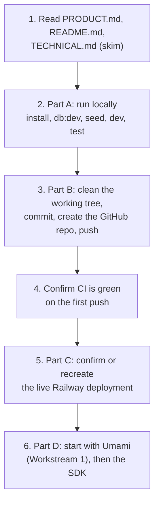
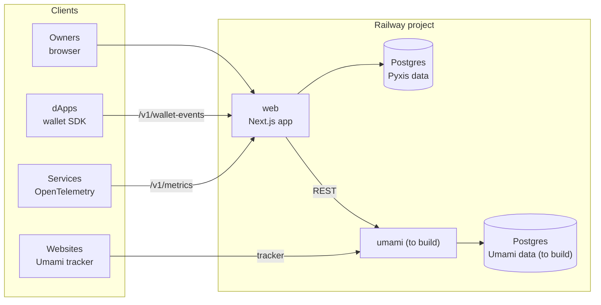
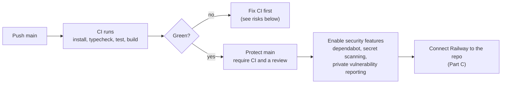
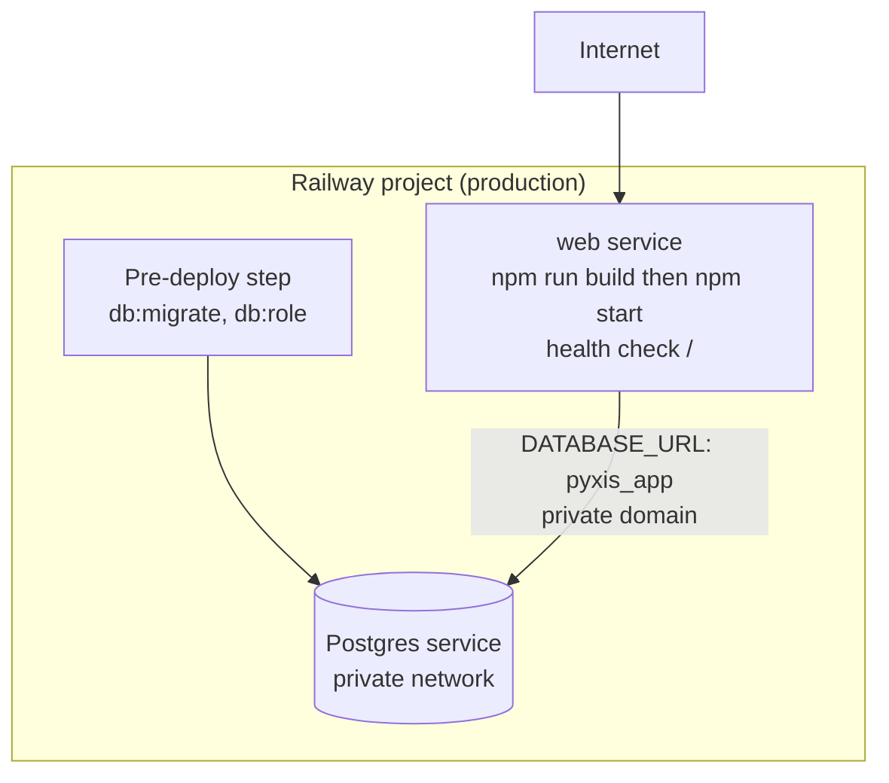
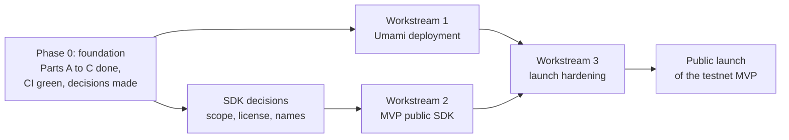
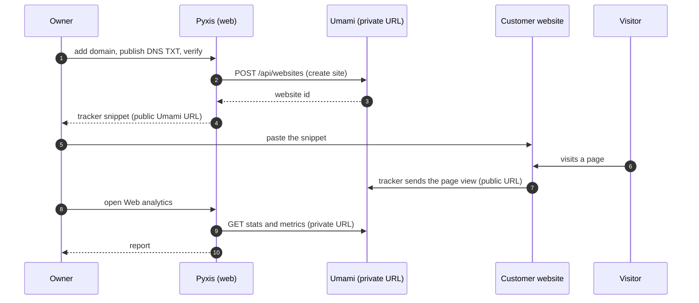
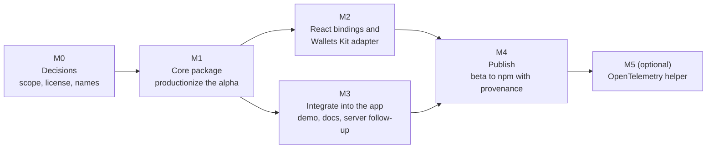

# Pyxis: handover and build plan

For the engineer or agent taking over the project. This document has two jobs:

1. **Get you running:** set up locally, put the code on GitHub, and stand up a live deployment (Parts A to C).
2. **Tell you what to build next:** the public SDK and a real Umami deployment, in order, with acceptance criteria (Part D).

Written 2026-11-18 from the repository and the live Railway project as they stand today. Facts were read from source and from the Railway CLI; items marked **VERIFY** were not confirmed and need a quick check before you rely on them. Items marked **DECISION** need an answer from the project owner (collected in section 12).

## Contents

1. [Read this first](#1-read-this-first)
2. [Project snapshot](#2-project-snapshot)
3. [Access and secrets inventory](#3-access-and-secrets-inventory)
4. [Part A: set up locally](#4-part-a-set-up-locally)
5. [Part B: put the code on GitHub](#5-part-b-put-the-code-on-github)
6. [Part C: live deployment on Railway](#6-part-c-live-deployment-on-railway)
7. [Part D: build plan](#7-part-d-build-plan)
8. [Workstream 1: Umami deployment](#8-workstream-1-umami-deployment)
9. [Workstream 2: the MVP public SDK](#9-workstream-2-the-mvp-public-sdk)
10. [Workstream 3: launch hardening](#10-workstream-3-launch-hardening)
11. [Sequencing, risks and definition of done](#11-sequencing-risks-and-definition-of-done)
12. [Decisions needed from the owner](#12-decisions-needed-from-the-owner)
13. [Handover checklist for the outgoing owner](#13-handover-checklist-for-the-outgoing-owner)
14. [Reference index](#14-reference-index)

## 1. Read this first

**What this is.** Pyxis is a multi-tenant analytics service for Stellar projects: API metrics from OpenTelemetry, wallet-funnel events from a browser SDK, and web analytics from Umami. One Next.js 16 app contains the dashboards and the API; PostgreSQL stores everything with row-level security.

**Honest state in five lines.**

- The app is **built and deployed** to a testnet instance on Railway. It has never been used with a real wallet, real production traffic, or a real Umami.
- The code has **never been pushed anywhere**. The local git repo has one commit (the Create Next App template) and about 38 changed or new paths uncommitted. There is no GitHub remote, and CI has never run.
- There is **no LICENSE file**, no published SDK, no real Umami, and no private security contact.
- The visual redesign (dark, violet) is done and documented; do not redo it.
- Your first hour should be Part A, then Part B, so nothing exists only on one laptop.

**Rules you must not break** (full list in [PRODUCT.md](../PRODUCT.md)): store aggregates only and never personal data; the tenant comes from the credential, never the payload; wallet events are "reported", never "confirmed"; no claims of adoption, uptime or compliance; the product name and the "testnet MVP" wording are provisional.

**Gotcha you will hit:** this repo uses Next.js 16, which has breaking changes versus most documentation and model knowledge. Read [AGENTS.md](../AGENTS.md) and the matching guide in `node_modules/next/dist/docs/` before writing framework code.

### First-hour plan



## 2. Project snapshot

### 2.1 What exists

| Area | State | Where |
|---|---|---|
| Sign-in with a Stellar wallet (signed challenge) | Built; server-side verified by script; **not tried with a real browser wallet** | `src/server/auth/`, `src/lib/wallet.ts` |
| Projects, members, roles, operator role | Built | `src/app/api/v1/projects/`, `src/app/operator/` |
| Ingest keys (hashed, scoped, revocable) | Built | `src/server/keys.ts` |
| OTLP/HTTP JSON metrics receiver, route normalization, histograms | Built, tested | `src/app/v1/metrics/`, `src/server/ingest/` |
| Wallet-funnel endpoint and alpha SDK | Built (alpha); SDK is one unpublished file | `src/app/v1/wallet-events/`, `sdk/wallets-kit/` |
| Web analytics (site enrollment, domain verification, Umami client, report UI) | Built against a **fake** Umami only | `src/server/domain.ts`, `src/server/umami.ts` |
| Dashboards, settings and team, onboarding, operator view | Built; dark-first redesign | `src/app/projects/`, `src/components/pyxis/` |
| Docs: README, TECHNICAL, CONTRIBUTING, SECURITY, PRODUCT, DESIGN, ROADMAP, SDK spec | Written | repo root and `docs/` |

### 2.2 What does not exist yet

| Item | Needed for |
|---|---|
| GitHub repository, CI history, branch protection | Collaboration, safe changes |
| LICENSE, private security contact | Going public |
| A real Umami deployment, tested against the app | Web analytics (Workstream 1) |
| Published SDK packages | Public SDK (Workstream 2) |
| OTLP protobuf, rate limiting, security headers, quotas, exports, backups | Production readiness (Workstream 3, ROADMAP M2 and M3) |

### 2.3 What is live today

| Thing | Value |
|---|---|
| Railway workspace | the previous owner's **personal** Railway workspace (ask them for its name) |
| Railway project | named `stellar-pulse` in Railway (the product is now Pyxis; renaming the Railway project is optional), id `9ef394bc-9458-4c1c-bf04-7371f2ace85a`, environment `production` |
| Services | `web` (the Next.js app) and `Postgres` (Railway's PostgreSQL) |
| Public URL | `https://web-production-3c4c1c5f.up.railway.app` |
| Web variables (names only) | `DATABASE_URL`, `ADMIN_DATABASE_URL`, `PYXIS_APP_PASSWORD`, `OPERATOR_ACCOUNTS` (empty) |
| Umami | **not deployed**; the app shows "web analytics engine is not configured" |
| How it was deployed | `railway up --service web --ci` from a laptop (uploads the working folder, not GitHub) |

The live site runs the latest local code, which is **not committed anywhere**. Part B puts that exact code into git so the deployment is reproducible.

### 2.4 Architecture in one picture



## 3. Access and secrets inventory

Nothing below is a secret value. Secrets live only in the places named, and **must never be committed or pasted into chat**.

| Item | Status today | Action for the new owner |
|---|---|---|
| GitHub organization or repo | none | Create (Part B) |
| Railway project | owned by the previous owner's personal workspace | Either be invited or take ownership (section 6.2), or recreate in your own workspace (section 6.3) |
| Railway CLI login | previous owner's machine | Run `railway login` as yourself |
| npm account and the `@pyxis` scope | none; scope availability unchecked | **DECISION** (section 12); needed for Workstream 2 |
| Domain name for the app or Umami | none (Railway-provided `*.up.railway.app` only) | Optional; needed for a branded URL and for Umami's tracker host |
| Umami admin credentials | none | Create strong ones when you deploy Umami |
| Stellar testnet wallet | none supplied | Install Freighter, create a testnet account, fund it with Friendbot |

Secrets used by the system:

| Secret | Where it is set | Used by | Rotate by |
|---|---|---|---|
| `PYXIS_APP_PASSWORD` | Railway variable on `web` | `npm run db:role` sets it on the `pyxis_app` database role | Set a new value, run `npm run db:role`, update `DATABASE_URL` to match, redeploy |
| `DATABASE_URL` (runtime role) | Railway variable on `web` | App runtime | Update with the new password |
| `ADMIN_DATABASE_URL` (owner role) | Railway variable on `web`, a reference to the Postgres service | Migrations only | Rotate in the Postgres service |
| Ingest keys | In each project's database (hash only) | Customers' services | Revoke and recreate in the app |
| `OPERATOR_ACCOUNTS` | Railway variable on `web` | Grants the operator role | Edit the list; applies at that person's next sign-in |
| `UMAMI_USER`, `UMAMI_PASSWORD` (future) | Railway variable on `web` | Pyxis calling Umami's REST API | Change in Umami, then in Railway |
| `APP_SECRET` (future, Umami) | Railway variable on `umami` | Umami's session signing | Generate a new random value |

Default credentials that ship in the repo and **must not reach production unchanged**: migration 001 creates `pyxis_app` with the password `pyxis_app`; `docker-compose.yml` uses `postgres/postgres`, `umami/umami` and `APP_SECRET: change-me-in-real-deployments`. The live deployment already replaced the `pyxis_app` password; keep it that way.

## 4. Part A: set up locally

**Time:** about 20 minutes. **You need:** Node.js 22 (CI uses 22; the previous owner used 24 locally and it worked), npm, git. Docker is optional because an embedded PostgreSQL is included.

1. **Get the code.** Today there is no remote, so take it from the previous owner's folder or from the archive they give you. After Part B you will clone from GitHub instead.
2. **Install:**
   ```bash
   npm install --legacy-peer-deps
   ```
   The flag is required by the current peer-dependency ranges.
3. **Start the database** (own terminal, leave it running):
   ```bash
   npm run db:dev
   ```
   Starts a real PostgreSQL on port 54329 and applies the migrations. Data is stored in `.pyxis-data/` (git-ignored).
4. **Load synthetic data** and note the ingest keys it prints (shown once):
   ```bash
   npm run seed
   ```
5. **Run the app.** Add your own testnet Stellar public key to get the operator view:
   ```bash
   OPERATOR_ACCOUNTS=G...YOURKEY npm run dev
   ```
   PowerShell: `$env:OPERATOR_ACCOUNTS="G..."; npm run dev`.
6. **Check it works:**
   - Open <http://localhost:3000>. The landing page loads.
   - Run `npm run typecheck` and `npm test`. Both should pass. On Windows, a test teardown error about `EBUSY` and a `pyxis-pg-` temp folder is a known cleanup lock; the tests that ran have already passed.
   - Optional end-to-end check against the running app: `SMOKE_SECRET=S... npx tsx scripts/e2e-smoke.mts http://localhost:3000 <ingest-token>` (use a throwaway testnet secret key and a token from `npm run seed`).

**Sign in with a real wallet (first time ever, so expect surprises).** Install Freighter, switch it to Testnet, create and fund an account, then use "Connect wallet" on the sign-in page. This path has **never been run with a real wallet**. If it fails, check the browser console and `src/lib/wallet.ts` first. Write down what you find; it is the most valuable early bug report you can file.

| Symptom | Cause and fix |
|---|---|
| `service_unavailable` on sign-in | The database is not running; start `npm run db:dev` |
| `npm install` peer errors | Use `--legacy-peer-deps` |
| Port 3000 in use | Stop the other dev server or run `npx next dev -p 3100` |
| `tsconfig.json` changes after `next dev` | Next.js rewrites generated includes; keep only intentional changes |

## 5. Part B: put the code on GitHub

The whole project currently exists only in this working folder. Do this before anything else changes.

### 5.1 The state you are starting from

| Fact | Detail |
|---|---|
| Git history | 1 commit, `Initial commit from Create Next App`, on branch `master` |
| Remote | none |
| Working tree | 9 modified and 29 untracked paths (the entire product) |
| Large or tooling folders | `.agents/` (about 45 MB of AI-assistant skill packs), `.claude/` (about 7 MB), `.github/agents` and `.github/skills` (about 2 MB), `.impeccable/` (design-tool state, about 5 MB, mostly ignored screenshots) |
| Secrets in the tree | A scan found none: only all-zero placeholder tokens in `scripts/e2e-smoke.mts` and in docs. `.env*` files are git-ignored. |

### 5.2 Decide what goes into git

| Path | Recommendation | Why |
|---|---|---|
| `src/`, `db/`, `scripts/`, `sdk/`, `tests/`, `docs/`, `public/` if present | Commit | The product |
| `README.md`, `TECHNICAL.md`, `CONTRIBUTING.md`, `SECURITY.md`, `PRODUCT.md`, `DESIGN.md`, `ROADMAP.md` | Commit | Project truth |
| `package.json`, `package-lock.json`, `tsconfig.json`, `next.config.ts`, `components.json`, `vitest.config.mts`, `railway.json`, `docker-compose.yml`, `.gitignore` | Commit | Build and deploy |
| `.github/workflows/ci.yml` | Commit | CI |
| `.impeccable/design.json`, `.impeccable/surfaces/` | Commit | Durable design-system data the design tools read |
| `.agents/` | **Do not commit** | 45 MB of third-party skill packs; restorable from `skills-lock.json` |
| `.claude/`, `.github/agents/`, `.github/skills/` | **Do not commit** (recommended), **DECISION** if you want them shared | Local AI-assistant tooling; large; not part of the product |
| `skills-lock.json` | Commit | Lets anyone restore the skills |
| `.impeccable/` runtime folders (`review/`, `mocks/`, `questions/`) | Already self-ignored | Local state |
| `.env*`, `.pyxis-data/`, `.next*`, `node_modules/` | Never commit | Secrets, local data, build output |

Add these lines to `.gitignore` before the first commit:

```gitignore
# local AI-assistant tooling (restore from skills-lock.json)
/.agents/
/.claude/
/.github/agents/
/.github/skills/
# alternate Next.js build dirs used for verification
/.next-verify/
```

Note: [CONTRIBUTING.md](../CONTRIBUTING.md) mentions an optional design-detector command under `.claude/`. That tooling is optional; if you exclude it, the instruction is simply skipped.

### 5.3 Commit it cleanly

1. Rename the branch to match the intended default: `git branch -m master main`.
2. Confirm the tree is clean of junk: `git status --short`. You should see only the paths in the table above.
3. Review the three modified config files, which the framework or tooling may have touched: `tsconfig.json` and `next.config.ts` (intentional: a `BACKEND_URL` proxy and a `distDir` option), `package.json` (new dependencies, a `db:role` script).
4. Make **logical commits**, not one giant commit. Suggested split (Conventional Commits, see CONTRIBUTING):
   ```text
   chore: add .gitignore entries and tooling lock
   feat(db): schema, row-level security and migration runner
   feat(ingest): OTLP metrics and wallet-event endpoints
   feat(auth): wallet sign-in, sessions, keys and roles
   feat(app): dashboards, onboarding, settings and operator view
   feat(web): site verification and Umami client
   feat(sdk): alpha wallet-funnel SDK
   test: unit, database, wallet and web suites
   ci: GitHub Actions workflow and Railway config
   docs: README, TECHNICAL, CONTRIBUTING, SECURITY, product and design docs
   ```
   Commit messages in this plan may end with whatever attribution your team uses; none is required.
5. Run the three checks before the first push: `npm run typecheck`, `npm test`, `npm run build`.

### 5.4 Create the repository and push

Use the GitHub CLI (`gh`, installed on the previous owner's machine) or the website. Replace `<owner>`.

```bash
gh auth login
gh repo create <owner>/pyxis --private --source=. --remote=origin --description "Analytics for Stellar projects"
git push -u origin main
```

Start **private**. Make it public only after section 10's "before going public" items are done (a LICENSE, a security contact, and a final secret scan).

### 5.5 Configure the repository



| Setting | Value |
|---|---|
| Default branch | `main` |
| Branch protection on `main` | Require a pull request, require the `ci` workflow to pass, block force pushes |
| Security | Enable Dependabot alerts and updates, secret scanning with push protection, and **private vulnerability reporting** (then remove the maintainer note in [SECURITY.md](../SECURITY.md)) |
| Actions secrets | none needed for the current CI; add `RAILWAY_TOKEN` only if you later deploy from Actions |
| CODEOWNERS (optional) | Require review for `db/`, `src/server/`, `src/app/v1/` |
| Issue labels | `good first issue`, `help wanted`, `security` (do not use public issues for vulnerabilities) |

**Risk to expect on the very first CI run.** CI has never executed. It runs `npm ci --legacy-peer-deps`, `npm run typecheck`, `npm test` and `npm run build` on Ubuntu with Node 22 ([.github/workflows/ci.yml](../.github/workflows/ci.yml)). The database suite starts an **embedded PostgreSQL** (`embedded-postgres`); that package refuses to run as root and needs a writable temp directory, so the most likely failures are (a) the embedded Postgres binary on the runner, (b) peer-dependency resolution, (c) a type error that only shows with a clean install. Fix them in a small first pull request. If the embedded database cannot run in CI, switch the test setup to a `services: postgres` container in the workflow.

## 6. Part C: live deployment on Railway

### 6.1 Topology and process



How the current deployment is configured ([railway.json](../railway.json)):

| Setting | Value |
|---|---|
| Builder | Railpack, build command `npm run build` |
| Pre-deploy command | `npm run db:migrate && npm run db:role` |
| Start command | `npm run start` |
| Health check | `/` |
| Restart policy | on failure |

**Known issue:** on the first deployment the pre-deploy step did **not** run (it was deployed with `railway up` from a laptop). The schema had to be applied by hand with `railway ssh`. Config-as-code files like `railway.json` are also flagged by Railway as deprecated, working until 2026-12-01. After you connect GitHub, confirm the pre-deploy step runs; if it does not, apply migrations by hand (6.5) and consider migrating the config with `railway config migrate`.

### 6.2 Option 1: keep the existing Railway project

Use this if the previous owner invites you or transfers the project.

1. The previous owner adds you to the project or workspace in Railway (or transfers the project to a team workspace). **VERIFY** the current Railway options for transfers and for the plan you need; this repo cannot show them.
2. `npm i -g @railway/cli`, then `railway login`.
3. From the repo folder: `railway link` and choose the project (currently still named `stellar-pulse` in Railway), environment `production`.
4. Check what is there: `railway status`, `railway variables --service web --kv` (values are secrets; do not paste them anywhere).
5. Move deployments off the laptop: in the Railway dashboard, `web` service, Settings, Source: connect the GitHub repo and branch `main`. Keep CLI deploys (`railway up --service web --ci`) as a fallback.

### 6.3 Option 2: create a fresh deployment (new workspace)

Use this if you cannot take over the old project. These are the commands used originally, in order. Replace names as needed.

```bash
railway login
railway init --name pyxis --workspace "<your workspace name>"
railway add --database postgres                       # creates the Postgres service
# generate the runtime-role password locally; do not print it into logs you share
PW=$(openssl rand -hex 24)
DB=$(railway variables --service Postgres --kv | grep '^PGDATABASE=' | cut -d= -f2)
railway add --service web \
  --variables "PYXIS_APP_PASSWORD=$PW" \
  --variables 'ADMIN_DATABASE_URL=${{Postgres.DATABASE_URL}}' \
  --variables "DATABASE_URL=postgresql://pyxis_app:$PW@\${{Postgres.RAILWAY_PRIVATE_DOMAIN}}:5432/$DB" \
  --variables "OPERATOR_ACCOUNTS=G...your testnet public key"
railway up --service web --ci                          # build and deploy the working folder
railway domain --service web                           # generate the public URL
```

Then run the one-time migration if the pre-deploy step did not (6.5), and verify (6.4).

If you connect GitHub instead of using `railway up`, set the service's source repository and branch in the dashboard; Railway will then build on every push to `main`.

### 6.4 Verify the live deployment

Replace `$U` with the public URL.

```bash
curl -s -o /dev/null -w "%{http_code}\n" $U/                # 200
curl -s -o /dev/null -w "%{http_code}\n" $U/signin           # 200
curl -s $U/api/v1/me                                          # {"user":null}
# sign-in challenge for a valid (throwaway) public key: 200 with a nonce
curl -s -X POST $U/api/v1/auth/challenge -H 'content-type: application/json' \
  -d '{"account":"G...a valid testnet public key"}'
# unauthenticated ingest is rejected: 401
curl -s -o /dev/null -w "%{http_code}\n" -X POST $U/v1/metrics -H 'content-type: application/json' -d '{}'
```

| Check | Expected | If it fails |
|---|---|---|
| Home and sign-in pages | 200 | Read `railway logs --service web` |
| `/api/v1/me` | `{"user":null}` | The build is broken or the service is not running |
| Challenge request | 200 with `nonce` and `message` | `503 service_unavailable`: the database cannot be reached or the schema or role is missing (6.5) |
| Unauthenticated metrics | 401 | Routing problem |

Then sign in with a real testnet wallet, create a project, create a key, and send a test metric (use the e2e script or the snippet from the Keys page). **This is the first real end-to-end test; record the result.**

### 6.5 Migrations and the runtime role

The app must run as the non-owner role `pyxis_app`; the owner role only runs migrations. If the pre-deploy step did not run, apply it from inside the service (uses the service's own variables):

```bash
railway ssh --service web -- sh -c "npm run db:migrate && npm run db:role"
```

Expected output: `applied 001_init.sql` (first time) and `pyxis_app password updated`. A sign-in challenge that returns `service_unavailable` and a log line `password authentication failed for user "pyxis_app"` means the role or password step did not run.

### 6.5a After the rename to Pyxis: required changes on the live deployment

The product was renamed from "Stellar Pulse" to "Pyxis" (2026-11-18). The deployed service still runs the old code and still uses the old names. **Do these in order before deploying the renamed code**, otherwise the app cannot connect to its database.

| Step | Change | Why |
|---|---|---|
| 1 | In Railway, on the `web` service, add `PYXIS_APP_PASSWORD` with the **same value** as the existing `PULSE_APP_PASSWORD` | The code now reads the new variable name |
| 2 | Change `DATABASE_URL` so the user is `pyxis_app` instead of `pulse_app` (keep the password and host) | Migration 002 renames the database role `pulse_app` to `pyxis_app` |
| 3 | Deploy the renamed code. The pre-deploy step applies migration `002_rename_to_pyxis.sql` (renames the role and the `pulse_*` functions to `pyxis_*`) and then `npm run db:role` sets the role's password from `PYXIS_APP_PASSWORD` | One forward migration; migration 001 is unchanged |
| 4 | If the pre-deploy step does not run, apply it by hand (section 6.5) | Known deployment issue |
| 5 | Remove the old `PULSE_APP_PASSWORD` variable once the new deployment is healthy | Cleanup |
| 6 | Verify (section 6.4) | Sign-in challenge returns 200 |

Changes visible to users and integrators, all deliberate because there are no real users yet:

| Old | New | Effect |
|---|---|---|
| Ingest key prefix `sp_live_` | `pyx_live_` | Existing keys still work if the prefix is swapped: change `sp_live_<id>.<secret>` to `pyx_live_<id>.<secret>`. Only the secret and id are stored |
| Session cookie `pulse_session` | `pyxis_session` | Everyone signs in again once |
| Domain verification: DNS TXT host `_stellar-pulse.<domain>` and file `/.well-known/stellar-pulse.txt` | `_pyxis.<domain>` and `/.well-known/pyxis.txt` | Sites that were pending must publish at the new location (the stored token still works; its `sp-verify=` prefix is unchanged for existing rows, new rows use `pyxis-verify=`) |
| Sign-in message `Stellar Pulse sign-in (testnet)` | `Pyxis sign-in (testnet)` | A challenge issued before the deploy and signed after it will fail once; retry |
| SDK scope `@stellar-pulse/*` | `@pyxis-hq/*` (provisional until the npm scope is confirmed) | Nothing was published |
| Local dev database `pulse`, folder `.pulse-data` | `pyxis`, `.pyxis-data` | `npm run db:dev` creates a fresh database; the old `.pulse-data` folder can be deleted |
| Environment variable `PULSE_APP_PASSWORD` | `PYXIS_APP_PASSWORD` | See step 1 |

The Railway project itself is still named `stellar-pulse`; renaming it in the Railway dashboard is optional and has no effect on the app.

### 6.6 Operating notes

| Topic | Guidance |
|---|---|
| Logs | `railway logs --service web` (the app only logs the sign-in failure path; there is no structured logging) |
| Redeploy | `railway up --service web --ci`, or push to `main` once GitHub is connected |
| Rollback | Redeploy a previous successful deployment from the Railway dashboard; do not run a migration backwards (migrations are forward-only) |
| Backups | **None configured.** Enable Railway's database backups or a scheduled dump before real users; rehearse a restore (Workstream 3) |
| Cost | Unknown; check Railway's current pricing and your plan. The Umami service and its database will add usage |
| Custom domain | Optional; add it in the Railway service settings and point DNS at it. Needed for a branded host and for Umami's tracker URL |
| Debugging with a local UI | Set `BACKEND_URL` in `.env.local` to proxy to the live backend |

## 7. Part D: build plan

Three workstreams, in this order. The first two are what was asked for; the third is the minimum work to make a public launch responsible.



Workstreams 1 and 2 are independent and can run in parallel with two people; with one person, do Umami first because the web-analytics half of the product is otherwise unproven. Effort figures below are **rough estimates in working days for one engineer familiar with the stack**; treat them as planning ranges, not commitments.

## 8. Workstream 1: Umami deployment

**Goal:** a real, pinned, secured Umami running next to Pyxis, with the web-analytics flow proven end to end on a real domain.

**Why it matters:** the Umami client (`src/server/umami.ts`) has only ever been tested against a fake server. Whether it works against a real Umami release is unknown.

### 8.1 Design



| Decision | Recommendation |
|---|---|
| Two URLs | `UMAMI_URL` is the **private** service address (server to server), `UMAMI_PUBLIC_URL` is the **public** HTTPS address the tracker script loads from |
| Database | A **separate** PostgreSQL service for Umami (never Pyxis's database); the compose file already separates them |
| Account | A **dedicated admin user** for Pyxis's REST calls with a long random password; change Umami's default admin password immediately. Default login is believed to be `admin` / `umami` (**VERIFY** against the Umami version you deploy) |
| Version | Pin the image **by digest**, not `latest` (ADR-001 in the code is a TODO for exactly this) |
| Tracker name | Consider serving the script under a neutral name to avoid ad-blockers (**VERIFY** the current Umami setting for a custom script name) |

### 8.2 Tasks

| # | Task | Acceptance | Estimate |
|---|---|---|---|
| 1.1 | Run Umami **locally** first: `docker compose up umami-db umami`, create the admin user, change the default password | Log in at <http://localhost:3200> with your own credentials | 0.5 d |
| 1.2 | Point a local Pyxis at it: set `UMAMI_URL=http://localhost:3200`, `UMAMI_USER`, `UMAMI_PASSWORD`, `UMAMI_PUBLIC_URL`; add a site, verify a domain you control (use a tunnel or a real test domain), install the snippet on a test page | A verified site appears; **a real page view shows in Pyxis's web report** | 1 d |
| 1.3 | **Reconcile the client with the real API.** Compare `src/server/umami.ts` against the running version: login response, `POST /api/websites`, the `stats` shape (numbers versus `{ value }`), `metrics` types (`referrer`, `country`, `browser`, `device`) and date parameters. Fix differences and update `tests/web.test.ts` fixtures to match reality | Client works against the real instance; tests updated; no behavior claimed that was not observed | 1 to 2 d |
| 1.4 | Pin the image by digest and record it | Digest committed in the compose file or the Railway service; `latest` removed | 0.5 d |
| 1.5 | Deploy to Railway: add a second `Postgres` service for Umami and a `umami` service from the image (dashboard: New, Docker Image; the CLI `--image` flag exists in recent versions, **VERIFY**). Variables: `DATABASE_URL` (reference to the Umami Postgres), `APP_SECRET` (new long random value), and the port Umami listens on (**VERIFY**: Umami defaults to 3000; match Railway's `PORT`) | Umami reachable over HTTPS; its database is separate from Pyxis's | 1 d |
| 1.6 | Generate a public domain for `umami`; set on `web`: `UMAMI_URL` (private address, `http://<service>.railway.internal:<port>`), `UMAMI_PUBLIC_URL` (public `https://...`), `UMAMI_USER`, `UMAMI_PASSWORD` | `web` redeploys; adding a site no longer says the engine is not configured | 0.5 d |
| 1.7 | **Live end-to-end test on a real domain**: add, verify (DNS TXT or the `/.well-known/pyxis.txt` file), install snippet, generate traffic, read the report | Page views, referrers, countries, browsers and devices appear; tracker is not blocked by common ad-blockers (test one) | 1 d |
| 1.8 | Operations: Umami backup, upgrade procedure (migrate by digest), how to rotate `APP_SECRET` and the Pyxis service account; document in [TECHNICAL.md](../TECHNICAL.md) section 15 | Runbook written and rehearsed once | 1 d |
| 1.9 | Privacy review of web analytics: what Umami stores (it counts countries and browsers) versus Pyxis's "no IPs" claim. Make the landing page and docs say exactly what Umami does, nothing more | Copy matches Umami's real behavior; no unverified claim | 0.5 d |

**Exit criteria:** a real page view on a real verified domain appears in Pyxis; Umami is pinned, separate, backed up and documented; every web-analytics claim in the UI matches what was observed.

**Risks:** the Umami API shape differs from the client (likely, plan time for task 1.3); Railway port or private-network details differ from assumptions; ad-blockers block the default script name; DNS propagation delays the live test.

## 9. Workstream 2: the MVP public SDK

**Goal:** a public, installable wallet-funnel SDK (plus, if time allows, an OpenTelemetry helper) that integrators can use in minutes and that cannot leak personal data.

**Source of truth:** [docs/sdk-build-spec.md](sdk-build-spec.md) is the full specification (server contracts, public API, behavior rules, defect list for the alpha, packaging, docs, acceptance). Read it end to end before starting. This section only schedules it.

### 9.1 Milestones



### 9.2 Tasks

| # | Task | Acceptance | Estimate |
|---|---|---|---|
| 2.0 | **Decisions** (section 12): npm scope and package names, license, whether to store `flow`. Add a `LICENSE` file | Decisions recorded; LICENSE committed | 0.5 d plus owner time |
| 2.1 | Workspace: add npm workspaces (`sdk/*`), create `sdk/wallets-kit/package.json`, `tsup` build (ESM, CJS, types), `exports` map, `sideEffects: false`, size-limit, publint and attw checks (spec section 9) | `npm run build -w` produces a valid package; checks pass | 1 d |
| 2.2 | Port the alpha code and **fix the 11 listed defects** (flush on page hide, backoff and circuit breaker, surface rejections, SSR-safe constructor, runtime stripping of unknown properties, consent and Do Not Track, `SDK_VERSION` from `package.json`) | Behavior tests for every rule in spec section 7.2 pass | 3 to 4 d |
| 2.3 | Contract tests: every emitted event passes the server's `validateWalletBatch` with zero rejections; a fuzz test proves no address-like or signature-like data can reach the request body | Tests green in CI | 1 d |
| 2.4 | React bindings (`/react` subpath): provider and hook, StrictMode and RSC safe | Tests green; example app works | 1 d |
| 2.5 | Wallets Kit adapter (`/stellar-wallets-kit` subpath): wrap `authModal` and `signTransaction`, never touch addresses or XDR; **VERIFY** the installed `@creit.tech/stellar-wallets-kit` API first | Integration test with a fake kit; adapter removable and transparent | 2 d |
| 2.6 | Integrate into the app: demo imports the package via the workspace, add an "Install the SDK" step to the Keys page and onboarding checklist, replace the funnel empty-state text (spec section 11) | Demo unchanged in behavior; copy honest; design system followed | 1 d |
| 2.7 | **Server follow-up:** make `/v1/wallet-events` update the key's `last_used_at` and write an `ingestion_audit` row (spec 3.3 item 9) | Test added; Keys page shows last used for wallet-only keys | 0.5 d |
| 2.8 | Docs: README per package, "what is sent" table verified by a test, troubleshooting table by server code, examples (vanilla, React, Wallets Kit, Next.js) | Docs contain no adoption, uptime or "confirmed" claims | 1.5 d |
| 2.9 | Consumer smoke tests: Vite app, Next.js app, plain Node each send one event to a locally running Pyxis | All three show counts on the Wallet funnel page | 1 d |
| 2.10 | Release pipeline: Changesets, GitHub Actions publish with provenance, publish `0.1.0-beta.0` (**after** owner approval) | Package installable from npm; changelog generated | 1 d |
| 2.11 | (Optional, P2) `@pyxis-hq/otel` helper: delta-temporality JSON exporter, HTTP-duration view only, contract test against `parseOtlpMetrics` (spec section 8) | Helper output parses with zero drops; real sample service reconciles on the dashboard | 3 d |

**Exit criteria (MVP SDK):** the acceptance list in [docs/sdk-build-spec.md](sdk-build-spec.md) section 13 is green and evidenced by test runs, a beta is published with provenance, and the demo plus the Keys page use the published shape. 1.0 requires a human decision.

**Risks:** the npm scope is taken; the Wallets Kit API differs between versions; the browser wallet path is untested with a real wallet; `keepalive` and CORS behave differently across browsers; scope creep into a read or query SDK (explicitly out of scope: no key-authenticated read API exists).

## 10. Workstream 3: launch hardening

Do these before making the repository or the product public.

| # | Item | Why | Estimate |
|---|---|---|---|
| 3.1 | Add `LICENSE` (planned: Apache-2.0, owner to confirm) and then the phrase "open-source" may return to the site | Legal clarity; currently avoided in copy | 0.25 d |
| 3.2 | Private security contact: enable GitHub private vulnerability reporting and edit [SECURITY.md](../SECURITY.md) | A reporter can reach you safely | 0.25 d |
| 3.3 | Rate limiting for `/v1/*` and sign-in (proxy, WAF or middleware) | No limits exist today beyond size caps | 1 to 2 d |
| 3.4 | HTTP security headers and a CSP in `next.config.ts` | None are set today | 1 d |
| 3.5 | Operator flag freshness: evaluate `OPERATOR_ACCOUNTS` per request, not only at sign-in | A removed operator keeps access until next sign-in | 0.5 d |
| 3.6 | Purge `auth_challenges` and expired `sessions` on a schedule | They grow without bound | 0.5 d |
| 3.7 | Backups and a rehearsed restore for both databases | No backups configured | 1 d |
| 3.8 | Dependency, secret and static-analysis scanning in CI | None today | 0.5 d |
| 3.9 | First real end-to-end test with a real wallet and real traffic; record results and fix defects | Never done | 2 d |
| 3.10 | Final copy review: no adoption, uptime or compliance claims; Umami privacy wording from task 1.9 | Product rule | 0.5 d |
| 3.11 | Make the repository public (after 3.1, 3.2 and a final secret scan) | Public launch | 0.25 d |

Also on the ROADMAP (not required for the testnet MVP launch): OTLP protobuf, quotas UI, exports, 24-month rollups, bot detection, high availability, load tests.

## 11. Sequencing, risks and definition of done

### 11.1 Suggested order (one engineer)

| Step | Work | Output |
|---|---|---|
| 1 | Parts A, B | Code on GitHub, CI green |
| 2 | Part C | Confirmed live deployment, first real-wallet test recorded |
| 3 | Workstream 3 items 3.1 to 3.2 | License and security contact in place |
| 4 | Workstream 1 | Real Umami proven, pinned, deployed |
| 5 | Workstream 2, tasks 2.0 to 2.9 | SDK built and integrated |
| 6 | Workstream 2, task 2.10 | Beta published |
| 7 | Workstream 3 remainder | Launch-ready |
| 8 | Workstream 3, task 3.11 | Public |

With two people: one takes Workstream 1, the other Workstream 2 after step 3.

### 11.2 Risk register

| Risk | Likelihood | Impact | Mitigation |
|---|---|---|---|
| First CI run fails (embedded PostgreSQL, peers, types) | High | Blocks protection of `main` | Fix in a small first PR; fall back to a Postgres service container |
| Real wallet sign-in fails (never tested) | Medium | Product unusable for real users | Test in Part A and C; read `src/lib/wallet.ts` |
| Umami API differs from the client | High | Web analytics broken | Task 1.3; update tests to real fixtures |
| Pre-deploy migration does not run on Railway | Medium | `service_unavailable` after deploy | 6.5 manual step; verify after each deploy |
| npm scope unavailable | Medium | Rename SDK packages | Decide early (task 2.0) |
| Data loss with no backups | Medium | Loss of all analytics | Task 3.7 before real users |
| Abuse with no rate limiting | Medium | Cost and availability | Task 3.3 before public launch |
| Over-claiming in copy | Medium | Breaks a hard product rule | Review with task 3.10 |
| Railway cost or plan limits | Unknown | Deployment blocked | Check pricing early |

### 11.3 Definition of done for "live MVP with SDK and Umami"

| # | Criterion |
|---|---|
| 1 | The code is on GitHub on `main`, protected, with CI green |
| 2 | A live HTTPS deployment reproduces from the repository (not from a laptop) and its migrations apply automatically or by a documented step |
| 3 | A real testnet wallet can sign in, create a project and a key |
| 4 | A real service sends OpenTelemetry metrics and the dashboard numbers reconcile |
| 5 | The published SDK sends wallet events from a real dApp or the demo and the funnel shows counts, labelled "reported" |
| 6 | Umami is deployed, pinned and separate; a real page view on a verified domain appears in Pyxis |
| 7 | LICENSE, private security contact, rate limiting, security headers and backups are in place |
| 8 | README, TECHNICAL, SECURITY and the SDK docs match what the software does, with no unverified claims |

## 12. Decisions needed from the owner

| # | Decision | Needed by | Default if you must proceed |
|---|---|---|---|
| 1 | Who owns the Railway project and billing; transfer or recreate | Part C | Recreate in your own workspace |
| 2 | GitHub organization or account and repository name | Part B | Private repo `pyxis` |
| 3 | License | Before public (3.1) | Apache-2.0 (as stated in the ROADMAP) |
| 4 | npm scope and package names; who owns the npm account | Task 2.0 | `@pyxis-hq/wallets-kit` if available |
| 5 | Commit the AI-assistant tooling folders or not | Part B | Do not commit (restore from `skills-lock.json`) |
| 6 | Custom domain for the app and for Umami | Workstream 1 | Railway-generated hosts |
| 7 | Store `flow` (per-flow funnels) | Task 2.2 | No; do not expose `flow` yet |
| 8 | Support OTLP protobuf now or later | Workstream 3 | Later; keep JSON |
| 9 | Keep the product name "Pyxis" | Before publishing packages | Keep; it is provisional |
| 10 | Safe-harbor wording and response targets in SECURITY.md | Before public | Keep the proposed targets; owner reviews wording |

## 13. Handover checklist for the outgoing owner

| Done | Item |
|---|---|
| [ ] | Give the new owner a copy of the working folder (or push it to a private GitHub repo first) |
| [ ] | Invite the new owner to the Railway project, or confirm they will recreate it |
| [ ] | Share, through a password manager (never chat or email), the values of `PYXIS_APP_PASSWORD`, `DATABASE_URL` and `ADMIN_DATABASE_URL`, or tell them to rotate (section 3) |
| [ ] | Tell them which Stellar account(s) are in `OPERATOR_ACCOUNTS` (currently empty) |
| [ ] | Share any ingest keys created during testing and revoke them if they are not needed |
| [ ] | Confirm there are no other accounts or services created for this project (npm, domains, analytics) |
| [ ] | Walk through the live site once together, including the first wallet sign-in if possible |
| [ ] | Tell the new owner about the known issues: pre-deploy step, never-tested wallet path, fake-only Umami tests |

## 14. Reference index

| Need | File |
|---|---|
| Product rules and users | [PRODUCT.md](../PRODUCT.md) |
| Setup, scripts, limits, status | [README.md](../README.md) |
| How it works, API, data model, flows | [TECHNICAL.md](../TECHNICAL.md) |
| Process for changes | [CONTRIBUTING.md](../CONTRIBUTING.md) |
| Security policy, threat model, hardening | [SECURITY.md](../SECURITY.md) |
| Visual system | [DESIGN.md](../DESIGN.md) |
| Original plan and SCF mapping | [ROADMAP.md](../ROADMAP.md) |
| SDK specification | [docs/sdk-build-spec.md](sdk-build-spec.md) |
| Design research | [docs/design-teardown.md](design-teardown.md) |
| CI | [.github/workflows/ci.yml](../.github/workflows/ci.yml) |
| Railway config | [railway.json](../railway.json) |
| Docker evaluation stack (unverified) | [docker-compose.yml](../docker-compose.yml) |
| The README also mentions a documentation pack at `../stellar-pulse-documentation/` | Not in this repo; ask the previous owner for it |
