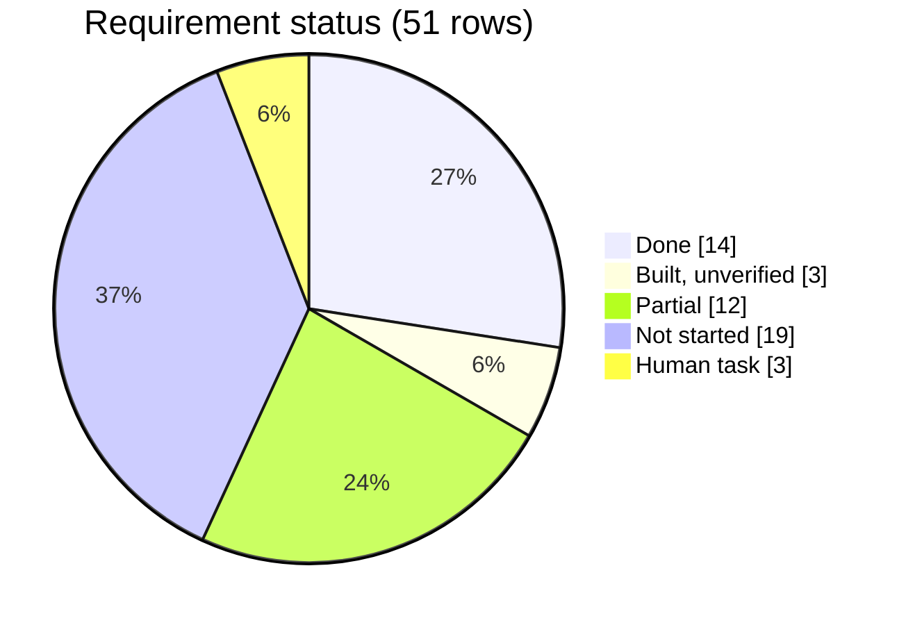

# SCF RFP acceptance matrix

Traceability from every requirement in the Stellar Community Fund RFP **"Web and API Analytics for Stellar Ecosystem Projects"** to what this repository does today, the evidence a reviewer can check, and what is still missing.

- **Source:** <https://stellar.gitbook.io/scf-handbook/scf-awards/build-award/rfp-track#web-and-api-analytics-for-stellar-ecosystem-projects>
- **Last reviewed:** 2026-11-18, against `main` of the public repository <https://github.com/Pyxis-Hq/pyxis>.
- **Companion:** the actionable list is in [rfp-checklist.md](rfp-checklist.md). Planning context is in [ROADMAP.md](../ROADMAP.md) and [handover-build-plan.md](handover-build-plan.md).

> **How the RFP text was captured.** The requirement wording below was read from the live handbook page on the review date and condensed; it is a faithful outline but not a verbatim copy. Re-read the original page before submitting anything. [ROADMAP.md](../ROADMAP.md) separately notes that the proposal PDF could not be rendered and should be re-checked against the plan.

> **Truthfulness rule.** A row is marked "Done" only if the capability exists in code **and** is covered by an automated test or was observed working. Anything built but never exercised against a real counterpart (a real wallet, a real Umami, real traffic) is "Built, unverified". Nothing in this matrix claims adoption, uptime or compliance, because the repository contains no evidence of any.

## 1. Status legend

| Status | Meaning |
|---|---|
| **Done** | Exists in code and is covered by an automated test or was observed working |
| **Built, unverified** | Code exists but has never been run against the real thing it depends on |
| **Partial** | Some of the requirement is met; the gap column says what is missing |
| **Not started** | No implementation or document exists |
| **Human task** | Cannot be built; needs people, consent, accounts or decisions |

Phase refers to [ROADMAP.md](../ROADMAP.md): **MVP** (Tranche 1), **M0** (award acceptance), **M2** (testnet and ecosystem), **M3** (mainnet and handover-ready).

## 2. Summary

| Area | Done | Built, unverified | Partial | Not started | Human task | Total |
|---|---|---|---|---|---|---|
| General (3.1) | 4 | 0 | 3 | 1 | 1 | 9 |
| Web analytics (3.2) | 0 | 2 | 4 | 9 | 0 | 15 |
| API analytics (3.3) | 7 | 1 | 1 | 0 | 0 | 9 |
| Hosting, support, handover (3.4) | 1 | 0 | 0 | 5 | 1 | 7 |
| Expected deliverables (5) | 2 | 0 | 4 | 4 | 1 | 11 |
| **All requirements** | **14** | **3** | **12** | **19** | **3** | **51** |

Rows in sections 3 to 7 only. Section 8 (evaluation criteria) is scored on the proposal and is not counted here. "Done" means built and covered by a test or observed working; it does not mean the requirement is fully satisfied at the end of the project (see each row's gap).

## 3. General requirements (RFP 3.1)

| ID | Requirement | Status | Evidence | Gap and next step | Phase |
|---|---|---|---|---|---|
| G1 | Multi-tenant with strict isolation: each tenant sees only its own data | Done | Row-level security on every tenant table under a non-owner role (`db/migrations/001_init.sql`, `src/server/db.ts`); `tests/db.test.ts` (tenant A cannot read or write tenant B, no context returns nothing, pooled connections do not leak context); `scripts/e2e-smoke.mts` cross-tenant 404 checks. Verify: `npm test` | Every new table needs a policy and a negative test | MVP |
| G2 | SCF operators have a global view | Done | Operator role from `OPERATOR_ACCOUNTS`; `src/app/api/v1/operator/overview/route.ts` returns aggregates only and audits each read; e2e: "operator sees aggregates", "operator payload has no keys, members or accounts". Covers API metrics only; web metrics are tracked in W15 | None for API metrics | MVP |
| G3 | Self-service enrollment for any Stellar-built project | Done | Anyone who signs in with a Stellar wallet can create a project (`POST /api/v1/projects`); sign-in verified by e2e | Pyxis does not check that a project is Stellar-built; the RFP handles that by removal (G4) | MVP |
| G4 | SCF can remove non-ecosystem projects | Partial | Operators can set `active`, `suspended` or `archived` with an audit row (`PATCH /api/v1/operator/projects/:id/status`); a suspended project's keys stop working | The UI offers only suspend and reinstate; no delete or erasure of a removed project's data; no documented removal policy | MVP, M2 |
| G5 | Ability to later move to an approval-required model | Partial | The schema already has a `pending` project status | No approval workflow or UI; new projects start active | M2 |
| G6 | All code under an OSI-approved license, in a single monorepo | Partial | `LICENSE` (Apache-2.0, an OSI-approved license) added 2026-11-18; `package.json` declares it; the code is on GitHub (`Pyxis-Hq/pyxis`) | The repo is one package with an `sdk/` folder, not a true monorepo with workspaces ([handover plan](handover-build-plan.md) task 2.1) | M0 |
| G7 | Zero fees to tenants, SCF or anyone else | Done | No billing, payment or metering code exists in `src/` or `db/` | State "no fees" explicitly in the README and onboarding docs | MVP |
| G8 | SCF operators can generate and revoke API keys for downstream machine access to metrics | Not started | Keys are per project and member-only (`src/app/api/v1/projects/[id]/keys/`); the `query` key scope exists in the database but **no route consumes it**; no operator key UI; no read API | Design a read or export API with operator-issued, revocable keys ([sdk-build-spec.md](sdk-build-spec.md) section 12) | M2 |
| G9 | Builders unknown to SCF are not eligible | Human task | Not a software requirement | Proposer eligibility, outside the code | n/a |

## 4. Web analytics (RFP 3.2)

| ID | Requirement | Status | Evidence | Gap and next step | Phase |
|---|---|---|---|---|---|
| W1 | Events come only from frontend code | Built, unverified | Web analytics are collected only by the Umami tracker script that Pyxis issues (`src/server/umami.ts`, `snippet()`); Pyxis has no server-side path for web events | Verify against a real Umami ([handover plan](handover-build-plan.md) Workstream 1) | MVP |
| W2 | Bot-detection and anti-inflation strategy (real browser JavaScript execution versus server-side posts; skepticism toward many fingerprints from one IP) | Not started | None. Umami has its own bot detection (**VERIFY** which behavior the pinned version provides) | Write the strategy, confirm what Umami provides, add measures for the rest | M2 |
| W3 | Low-friction integration for static HTML, SPAs and SSR frameworks | Partial | One `<script defer ...>` snippet is issued per verified domain and shown in the app | Not tested on SPAs or SSR; no integration guides or examples | MVP, M2 |
| W4 | Tracking script pinned to a specific version; no dynamic remote updates | Not started | The snippet loads from the operator's own Umami (no third-party script), but `docker-compose.yml` uses `latest` and nothing is pinned | Pin the Umami image by digest ([handover plan](handover-build-plan.md) task 1.4) | M2 |
| W5 | Described strategy against supply-chain attacks | Not started | A lockfile and a small dependency set; [SECURITY.md](../SECURITY.md) threat T12 states the gap | Write the strategy; add dependency and secret scanning to CI, SBOM and signed artifacts | M3 |
| W6 | Required metrics: page views, unique visitors, referrers, session duration, bounce rate, country, device and browser | Built, unverified | `Umami.report` and the Web analytics page show all of them (`src/server/umami.ts`, `src/app/projects/[id]/sites/page.tsx`); `tests/web.test.ts` uses a **fake** Umami | Run against a real Umami and fix any API differences | MVP |
| W7 | Nice to have: custom events | Not started | None | Optional | M2 |
| W8 | Nice to have: automatic capture of Stellar Wallets Kit events | Partial | An alpha wallet-funnel SDK and endpoint exist (`sdk/wallets-kit/`, `src/app/v1/wallet-events/`); events are tracked by hand | The Wallets Kit adapter that captures events automatically is specified in [sdk-build-spec.md](sdk-build-spec.md) section 7.5 | M2 |
| W9 | Script and endpoint names chosen so popular ad blockers do not block them | Not started | The README lists this as not done | Serve the tracker under a neutral name; test against common blockers (**VERIFY** Umami's custom-name setting) | M2 |
| W10 | GDPR compliance without client-side opt-in; state jurisdictions where opt-in is required | Not started | The design avoids personal data (no IPs or identifiers in Pyxis's own tables), but no statement or analysis exists | Legal and technical analysis, then a written statement | M2 |
| W11 | Declare data-residency choices | Not started | None | Decide hosting regions for Pyxis, its database and Umami; document them | M2 |
| W12 | Minimize right-to-erasure exposure; provide a tenant-triggered erasure workflow if personal data is stored | Not started | The roadmap lists the erasure workflow as outside the MVP. Pyxis stores member Stellar public keys (pseudonymous) | Decide whether any personal data is stored; build or justify the absence of a workflow | M2 |
| W13 | Document the full privacy and compliance strategy | Partial | [SECURITY.md](../SECURITY.md) (data classification, threat model), [PRODUCT.md](../PRODUCT.md) (privacy principles), [TECHNICAL.md](../TECHNICAL.md) section 17 | No consolidated compliance document | M2 |
| W14 | Tenant dashboard: private web metrics for selectable time ranges | Partial | The Web analytics page shows a private report per site | The range is **fixed to the last 7 days** (`hours: 168` in `sites/page.tsx`); add a range control like the API overview has | MVP |
| W15 | Global operator dashboard for web metrics, with filtering, sorting and side-by-side comparison | Not started | The operator overview covers API metrics only | Add web metrics to the operator view | M2 |

## 5. API analytics (RFP 3.3)

| ID | Requirement | Status | Evidence | Gap and next step | Phase |
|---|---|---|---|---|---|
| A1 | Tenants dual-export standard OpenTelemetry to their own APM and the SCF collector | Done | `POST /v1/metrics` (OTLP/HTTP JSON, key-authenticated); the app generates the dual-export settings (`src/app/projects/[id]/keys/page.tsx`); `tests/unit.test.ts`; e2e ingests and reconciles | JSON only. The OTel default is protobuf, so integrators must set `http/json` and delta temporality (protobuf is first on M2) | MVP, M2 |
| A2 | Collector drops traces, spans and deep logs; stores only counters and histograms in PostgreSQL | Done | `/v1/traces` and `/v1/logs` return `404 signal_not_supported`; a metric allowlist; per-minute buckets in `endpoint_metric_buckets`; e2e "traces rejected" | None | MVP |
| A3 | Required attributes: tenant and service identity, normalized route, status code, latency | Done | Service from `service.name`; tenant from the key (payload spoofing ignored, tested); route; status; latency histogram (`src/server/ingest/otlp.ts`). Pyxis reads the server-duration histogram (`http.server.request.duration`) as the "equivalent" to the RFP's `http.client.duration` | Confirm this equivalence with the SCF reviewers | MVP |
| A4 | Default path normalization (IDs, Stellar addresses, UUIDs, hashes, trailing slashes); no tenant rule editor | Done | `src/server/ingest/normalize.ts`; fixtures in `tests/unit.test.ts`; no rule editor exists | None | MVP |
| A5 | Design target of about 1,000,000 requests per day across all tenants | Built, unverified | Data is aggregated on write into 60-second buckets | No load test; dashboard queries merge bucket rows in application code, which may not scale to the target and range | M2 |
| A6 | Aggregated views retained at least 24 months | Partial | Nothing deletes data today, so it is retained | No rollup or retention job, no storage plan, no validation at volume | M2 |
| A7 | Same isolation rules as the web path | Done | Same row-level security, tested | None | MVP |
| A8 | Tenant dashboard: request volume, status-code distribution, latency percentiles (at least p50 and p95) | Done | `src/app/projects/[id]/page.tsx`: volume chart, status classes, p50, p95, p99 with previous-period deltas, endpoints table; percentiles tested in `tests/unit.test.ts` | UI verified against a mock API, not real data | MVP |
| A9 | Global dashboard: cross-project API comparison to find high- and low-usage services | Done | `src/app/operator/page.tsx`: totals, per-project table sortable by requests, p50, p95 and 5xx, side-by-side comparison of up to three, audited | No filter control; add one if the reviewers require "filtering" | MVP |

## 6. Hosting, support and handover (RFP 3.4)

| ID | Requirement | Status | Evidence | Gap and next step | Phase |
|---|---|---|---|---|---|
| H1 | Commitment: ingestion availability 99.99% | Not started | By design the product makes **no** availability claim ([PRODUCT.md](../PRODUCT.md)); ROADMAP records that a single host cannot honestly claim this | Decide the SLA to propose; build high availability and measure before committing | M3 |
| H2 | Commitment: dashboard availability 99.90% | Not started | As H1 | As H1 | M3 |
| H3 | Commitment: critical and high vulnerabilities patched within 24 hours | Not started | [SECURITY.md](../SECURITY.md) proposes response targets for reports, not a patch SLA; no dependency scanning in CI | Define the patch process, add scanning and alerts | M3 |
| H4 | Commitment: tickets answered within 5 business days, resolved within 10 | Not started | None (only security-report handling is described) | Write the support policy and set up the public tracker | M3 |
| H5 | No mandatory on-call; a public issue tracker is sufficient | Done | The repository is public with issues enabled, bug and feature issue forms, a pull request template, labels, and private vulnerability reporting for security reports (`.github/`, [CONTRIBUTING.md](../CONTRIBUTING.md)) | A support policy with response times is still open (H4) | M0 |
| H6 | 12-month hosting and support window after the final tranche | Human task | Not a software requirement | Contractual | n/a |
| H7 | Handover (months 6 to 12): transfer repository ownership, migrate all data, transfer the domain or permanently redirect; infrastructure rebuildable from the monorepo; a community operator runs a fully working system | Not started | Only an **internal** engineer handover exists ([handover-build-plan.md](handover-build-plan.md)); no infrastructure-as-code, no data-migration procedure, no operator-handover plan | Write the community-operator handover plan; build infrastructure-as-code; rehearse it | M3 |

## 7. Expected deliverables (RFP section 5)

| ID | Deliverable | Status | Evidence | Gap and next step | Phase |
|---|---|---|---|---|---|
| D1 | Fully functional multi-tenant web and API analytics platform meeting all requirements | Partial | Rows G, W, A above | See the gaps in sections 3 to 5 | MVP to M3 |
| D2 | Monorepo: all application code | Done | All application code is on `main` of the public repository <https://github.com/Pyxis-Hq/pyxis>: `src/`, `db/`, `scripts/`, `sdk/`, `tests/` | The monorepo-workspaces structure is tracked under G6 | MVP |
| D3 | Monorepo: full infrastructure-as-code | Not started | Only [railway.json](../railway.json) and an unverified [docker-compose.yml](../docker-compose.yml) | Real infrastructure-as-code for a full deployment | M3 |
| D4 | Monorepo: deployment documentation | Partial | [README.md](../README.md), [TECHNICAL.md](../TECHNICAL.md) section 15, [handover-build-plan.md](handover-build-plan.md) | A production deployment guide for a community operator | MVP, M3 |
| D5 | Monorepo: operator runbooks | Not started | Fragments only (manual migration step, hardening checklist in [SECURITY.md](../SECURITY.md)) | Backup and restore, key and secret rotation, upgrades, incident handling | M3 |
| D6 | Monorepo: tenant onboarding guide | Partial | In-app setup checklist and Keys and setup page; the README's "Get your first data point" | A standalone guide covering OpenTelemetry, the wallet SDK and domain verification | M3 |
| D7 | Monorepo: automated test suite | Done | `tests/` (unit, database isolation, wallet, web) and `scripts/e2e-smoke.mts`; Verify: `npm test` | CI (typecheck, tests, build) passes on GitHub Actions on Linux; no UI or load tests | MVP |
| D8 | Monorepo: security and privacy/compliance documentation | Partial | [SECURITY.md](../SECURITY.md), [TECHNICAL.md](../TECHNICAL.md) section 17, [PRODUCT.md](../PRODUCT.md) | No compliance document; the RFP's threat model and monitoring plan are due at Tranche 2 | M2 |
| D9 | Monorepo: monitoring and alerting baseline | Not started | Audit tables only (`ingestion_audit`, `operator_audit_events`) | Service metrics, dashboards and alerts | M3 |
| D10 | Live proof of adoption: 3 SCF-awarded projects on web analytics, 1 on API traffic, a live global operator view, and a tenant-perspective screen-capture video | Human task | The operator view exists; no pilots, consent letters or recordings. Demo data is labelled synthetic | Recruit pilots with written consent, instrument them, record both videos. Never fabricate | M2, M3 |
| D11 | Statements on data residency, GDPR jurisdictions without opt-in, and the right-to-erasure workflow | Not started | See W10 to W12 | Write and publish them | M2 |

## 8. Evaluation criteria (RFP section 4)

These are scored on the proposal, not on the software alone. The table shows what the repository contributes and what is missing.

| ID | Criterion | What the repo provides | Gap |
|---|---|---|---|
| E1 | Technical capability and soundness of the overall design | [TECHNICAL.md](../TECHNICAL.md), working vertical slice, tests | Real-world verification (wallet, Umami, load) |
| E2 | Rationale for choosing Umami or GoatCounter | The roadmap states Umami is chosen; the code cites a rationale document that is **not in this repo** | Write the rationale (Postgres-native, REST API, bot detection, version pinning, license) |
| E3 | Relevant prior experience; open-source maintainer track record; multi-year SCF and SDF history | Nothing in the repo can show this | Human evidence; the roadmap marks it a human task |
| E4 | Strength of the privacy-first and security posture | Privacy by omission, [SECURITY.md](../SECURITY.md) with an honest weakness list | Close the hardening items; independent review; compliance statements |
| E5 | Quality of multi-tenant isolation and access-control design | Row-level security, role model, tests ([TECHNICAL.md](../TECHNICAL.md) section 6) | None blocking |
| E6 | Realism and clarity of the proposed SLA and support model | Deliberately no claims | An SLA and support model that can honestly be delivered (H1 to H4) |
| E7 | Clarity and completeness of the handover plan | Internal engineer handover only | Community-operator handover plan (H7) |
| E8 | Coherent integration and onboarding plan for real SCF projects | In-app onboarding; the SDK and Umami plans | A concrete pilot and onboarding plan (D10) |
| E9 | Quality of the open-source monorepo structure and documentation | README, TECHNICAL, CONTRIBUTING, SECURITY, DESIGN, PRODUCT, ROADMAP | License, public repo, workspaces, CI history, infrastructure-as-code |

## 9. Reviewer demo script (MVP exit criteria)

From [ROADMAP.md](../ROADMAP.md) section 1. Each step should be rehearsed and recorded before a review.

| Step | Action | Proves |
|---|---|---|
| 1 | Clean clone: `docker compose up` (or `npm run db:dev`), `npm run db:migrate`, `npm run seed` | Reproducible deploy (D4) |
| 2 | `npm test` | Test suite incl. cross-tenant negatives, key lifecycle, normalization, histograms (D7, G1) |
| 3 | Open the public URL, sign in with a testnet Stellar account, create a project, create a key | Self-service enrollment (G3) |
| 4 | Send real OpenTelemetry metrics from a sample service with the generated settings | API ingestion (A1 to A4) |
| 5 | Show the tenant dashboard reconciling to the stored buckets | A8 |
| 6 | Show a second tenant that cannot see the first, then revoke a key and show it rejected | G1, key lifecycle |
| 7 | Show the operator view, side-by-side comparison and the audit log | G2, A9 |
| 8 | Run the `/demo` dApp on testnet and show funnel counts, labelled "reported" | Stellar relevance, W8 |
| 9 | Add a domain, verify it, install the tracker, show a real page view | W1, W6 (needs a real Umami) |

## 10. Maintenance

Update this file whenever a requirement's status changes: change the status, add the evidence (a file path or a test name), and refresh the summary counts and the "Last reviewed" date. A status may only move to **Done** with evidence a reviewer can run. Keep [rfp-checklist.md](rfp-checklist.md) in step with it.
