# SCF RFP delivery checklist

The actionable companion to [rfp-acceptance-matrix.md](rfp-acceptance-matrix.md). Every item carries the matrix ID it satisfies, what "done" means, and the evidence to collect. Checked boxes are items that are already done **and** covered by a test or observed working. Everything else is open.

- **RFP:** "Web and API Analytics for Stellar Ecosystem Projects" ([source](https://stellar.gitbook.io/scf-handbook/scf-awards/build-award/rfp-track#web-and-api-analytics-for-stellar-ecosystem-projects))
- **Last reviewed:** 2026-11-18
- **Tags:** `[code]` engineering work, `[docs]` writing, `[ops]` deployment and operations, `[human]` needs people, consent or decisions, `[verify]` run something real and record the result
- **Phases:** MVP, M0, M2, M3 as in [ROADMAP.md](../ROADMAP.md)

How to use it: work top to bottom within a section, tick a box only when the evidence exists, and then update the matching row in the matrix. Never tick an adoption, uptime or compliance item without real proof.

## 1. Order of work

```mermaid
flowchart LR
  A["1. Already done<br/>re-verify"] --> B["2. Foundation<br/>license, GitHub, CI"]
  B --> C["3. Verify the unverified<br/>real wallet, real Umami"]
  C --> D["4. Close MVP code gaps"]
  D --> E["5. Web analytics strategy<br/>and compliance docs"]
  E --> F["6. Operator and API depth"]
  F --> G["7. Operations, SLA, handover"]
  G --> H["8. Adoption proof"]
  H --> I["9. Submission gate"]
```

## 2. Already done (re-verify before every review)

Run `npm run typecheck`, `npm test` and `npm run build`, then the e2e script from [README.md](../README.md), and confirm each item still holds.

- [x] **G1** Multi-tenant strict isolation (row-level security, negative tests): `tests/db.test.ts`, e2e cross-tenant checks
- [x] **G2** Operator global view, aggregates only and audited: `operator/overview` route, e2e operator checks
- [x] **G3** Self-service enrollment: any Stellar wallet can create a project
- [x] **G7** No fees: no billing or payment code exists (also state it in the docs, see 5)
- [x] **A1** OTLP/HTTP JSON dual-export receiver, key-authenticated
- [x] **A2** Traces and logs rejected; only counters and histograms stored
- [x] **A3** Required attributes: tenant, service, normalized route, status, latency
- [x] **A4** Default path normalization (IDs, G/C/M addresses, UUIDs, hashes, trailing slash), no rule editor
- [x] **A7** Same isolation on the API path
- [x] **A8** Tenant dashboard: volume, status distribution, p50, p95 (and p99)
- [x] **A9** Operator cross-project API comparison, sortable, side by side
- [x] **D7** Automated test suite (CI configured, not yet run)

## 3. Foundation: license, GitHub, CI (M0)

See [handover-build-plan.md](handover-build-plan.md) Part B for the steps.

- [x] **G6** (license part) Apache-2.0 `LICENSE` added and stated in the README (2026-11-18). The monorepo-workspaces part of G6 stays open below
- [x] **D2** Code committed in logical commits and pushed to <https://github.com/Pyxis-Hq/pyxis> (2026-11-18)
- [x] **D7** CI is green on GitHub Actions (install, typecheck, tests, build) on `main` (2026-11-18); link a badge or run from the README if wanted
- [x] **H5** Public issue tracker with issue forms, a pull request template and labels (2026-11-18)
- [ ] **G6** `[code]` Adopt a single-monorepo structure with npm workspaces (`sdk/*`). *Done when:* the app and packages build from the root
- [x] **E9** Repository made public on 2026-11-18 after the license, private vulnerability reporting and a full-history secret scan; a clean clone typechecks, tests and builds
- [x] Branch protection (CI must pass, a pull request and one review, linear history, no force pushes; administrators may bypass), Dependabot alerts and updates, secret scanning with push protection, and private vulnerability reporting are enabled; the maintainer note is gone from [SECURITY.md](../SECURITY.md)

## 4. Verify what is built but unproven

These exist in code but have never run against the real thing. Record the result of each, pass or fail.

- [ ] `[verify]` Real wallet sign-in end to end (Freighter on testnet). *Evidence:* a recording or a written result. File defects found
- [ ] **W1, W6** `[verify]` Run Umami for real, point Pyxis at it, add and verify a real domain, see a real page view in the report with all required metrics. Reconcile `src/server/umami.ts` with the real API. *Evidence:* screenshot of the report; updated `tests/web.test.ts` fixtures ([handover plan](handover-build-plan.md) Workstream 1)
- [ ] **A5** `[verify]` Load test toward about 1,000,000 requests per day across tenants; check ingestion and dashboard query time over 30 and 90 days. *Evidence:* a short load report; fix or document the limits
- [ ] `[verify]` Run `/demo` with a real wallet and a funded testnet account; confirm funnel counts appear and are labelled "reported"
- [ ] `[verify]` Run a real OpenTelemetry sample service end to end; confirm dashboard numbers reconcile to the stored buckets

## 5. Close the MVP code and copy gaps

- [ ] **W14** `[code]` Add a time-range control to the web analytics report (it is fixed to 7 days). *Done when:* the report honors the selected range and a test or screenshot proves it
- [ ] **G4** `[code]` Operator UI for archiving a project, and a policy for removing a non-ecosystem project and its data. *Done when:* an operator can archive from the UI and the audit log records it
- [ ] **A9** `[code]` Add filtering to the operator overview if reviewers need it (sorting and comparison exist)
- [ ] **G7** `[docs]` State "no fees" explicitly in the README and onboarding docs
- [ ] **W3** `[docs]` Integration guides for static HTML, SPAs and SSR (React, Next.js) with a tested snippet each
- [ ] **A1** `[docs]` Make the OpenTelemetry JSON and delta settings impossible to miss in onboarding (default OTel exporters use protobuf and cumulative)
- [ ] **D6** `[docs]` Write the standalone tenant onboarding guide (OpenTelemetry, wallet SDK, domain verification)
- [ ] **D4** `[docs]` Production deployment guide for a community operator (not only the engineer handover)

## 6. Web analytics strategy and compliance (M2)

- [ ] **W2** `[docs]` `[code]` Bot-detection and anti-inflation strategy: what Umami provides, how real JavaScript execution is told apart from server-side posts, how many fingerprints per IP are treated. *Done when:* the strategy is written and tested where code is needed
- [ ] **W4** `[ops]` Pin the Umami image by digest and the tracker to a specific version; no dynamic remote updates
- [ ] **W5** `[docs]` `[ops]` Supply-chain strategy: lockfile policy, dependency and secret scanning in CI, SBOM, signed artifacts
- [ ] **W9** `[code]` `[verify]` Serve the tracker under a neutral name and test against common ad blockers
- [ ] **W10** `[docs]` `[human]` GDPR analysis: why no client-side opt-in is needed, and which jurisdictions would require it
- [ ] **W11** `[docs]` `[human]` Decide and declare data residency for Pyxis, its database and Umami
- [ ] **W12** `[docs]` `[code]` Decide whether any personal data is stored (member Stellar keys are pseudonymous) and either build the tenant-triggered erasure workflow or document why none is needed
- [ ] **W13** `[docs]` Consolidated privacy and compliance document
- [ ] **D11** `[docs]` Publish the three explicit statements: data residency, GDPR jurisdictions without opt-in, right-to-erasure workflow
- [ ] **W7, W8** `[code]` Optional: custom events; automatic Stellar Wallets Kit capture through the SDK adapter ([sdk-build-spec.md](sdk-build-spec.md) section 7.5)

## 7. Operator and API depth (M2)

- [ ] **G5** `[code]` Approval-required enrollment mode (the `pending` status exists in the schema)
- [ ] **G8** `[code]` Operator-issued, revocable API keys for downstream machine access to metrics, with a read or export API. *Done when:* an operator can mint a key, use it to read aggregates, and revoke it; with tests
- [ ] **W15** `[code]` Web metrics in the operator dashboard with filtering, sorting and side-by-side comparison
- [ ] **A6** `[code]` Rollups and a retention plan guaranteeing aggregated views for at least 24 months; test at volume
- [ ] **A1** `[code]` Accept OTLP `http/protobuf` (the OpenTelemetry default) in addition to JSON

## 8. Operations, SLA and handover (M3)

- [ ] **H1, H2** `[human]` `[ops]` Decide the SLA to propose (the RFP asks 99.99% ingestion and 99.90% dashboard). Build high availability and measure before committing. Make no claim until measured
- [ ] **H3** `[ops]` Vulnerability patch process and scanning to support a 24-hour patch commitment for critical and high issues
- [ ] **H4** `[docs]` Support policy: answer within 5 business days, resolve within 10, via the public tracker
- [ ] **D3** `[code]` Full infrastructure-as-code for a complete deployment
- [ ] **D5** `[docs]` Operator runbooks: backup and restore, key and secret rotation, upgrades, incidents
- [ ] **D9** `[ops]` Monitoring and alerting baseline for the service itself (ingestion rate, error rate, latency, database health)
- [ ] `[ops]` Backups enabled for both databases and a restore rehearsed
- [ ] **H7** `[docs]` Community-operator handover plan: repository ownership transfer, data migration, domain transfer or permanent redirect; rebuild everything from the repo. *Done when:* the handover is rehearsed once
- [ ] **D8** `[docs]` The RFP's threat model and monitoring plan (due at Tranche 2) and a security test report

## 9. Adoption proof (human, M2 and M3)

Nothing here can be built or faked.

- [ ] **D10** `[human]` Written consent from at least **three** real SCF-awarded projects for web analytics and **one** for API traffic
- [ ] **D10** `[ops]` Instrument those projects (tracker and OpenTelemetry dual-export) and confirm live data
- [ ] **D10** `[human]` Record the live global operator view video
- [ ] **D10** `[human]` Record the tenant-perspective screen-capture video
- [ ] **G9** `[human]` Confirm proposer eligibility with SCF (builders unknown to SCF are excluded)
- [ ] **H6** `[human]` Track the start of the 12-month hosting and support window (begins when the final tranche is approved)

## 10. Proposal-level items scored by reviewers (section 8 of the matrix)

- [ ] **E2** `[docs]` Write the Umami (or GoatCounter) rationale: Postgres-native, REST API, bot detection, version pinning, license
- [ ] **E3** `[human]` Assemble verifiable evidence of open-source maintenance and multi-year SCF or SDF work
- [ ] **E6** `[docs]` An SLA and support model that can honestly be delivered
- [ ] **E7** `[docs]` Clear, complete handover plan (see H7)
- [ ] **E8** `[docs]` Concrete onboarding plan for real SCF projects (see D10)
- [ ] `[docs]` Re-read the original RFP page and the proposal PDF and reconcile them with [ROADMAP.md](../ROADMAP.md) and this checklist

## 11. Submission gate

Do not submit until every line is true.

- [ ] The repository is public with a license, green CI and a clean-clone build
- [ ] A live HTTPS deployment reproduces from the repository
- [ ] Every claim in the UI and docs maps to something a reviewer can run (no adoption, uptime or compliance claim without evidence)
- [ ] The reviewer demo script in section 9 of the matrix has been rehearsed and recorded
- [ ] The matrix and this checklist are up to date with evidence links
- [ ] The privacy and compliance statements (D11) are published
- [ ] The open items above are either done or listed honestly as out of scope with their phase
