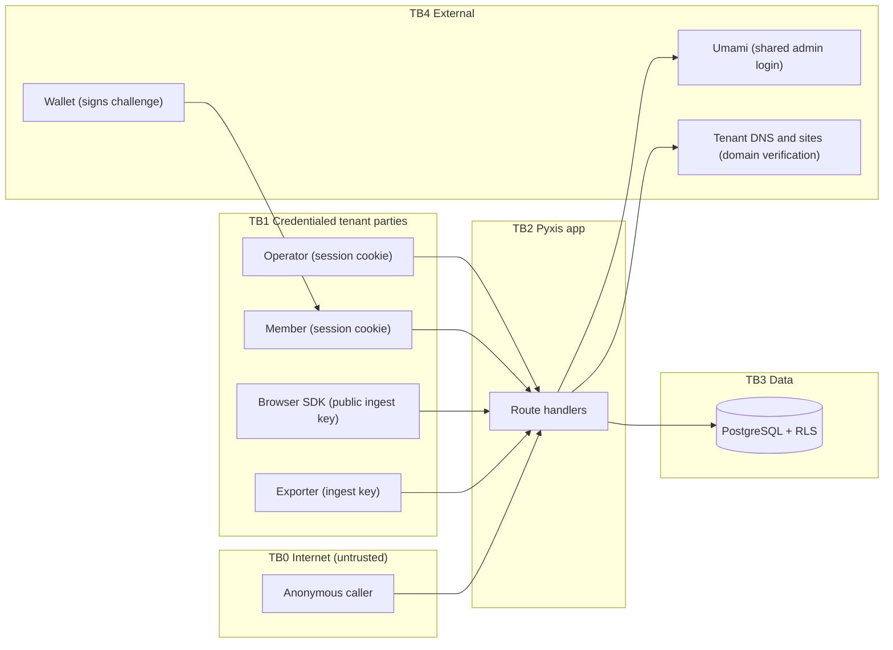

# Threat model (STRIDE)

**Status:** draft threat model. The Tranche 2 deliverable is a final, independently reviewed threat model and monitoring plan; this document is the **starting point, not that deliverable**. It has **not** been reviewed by an independent party and no independent security audit exists.
**Scope of this document:** assets, trust boundaries, the controls that are in place, the areas planned for hardening, and the monitoring plan outline. Detailed working notes are kept privately and are not published.
**Related:** [privacy-and-data-protection.md](privacy-and-data-protection.md), [../technical/architecture.md](../technical/architecture.md).

## 1. Scope and assets

| Asset | Why it matters |
|---|---|
| Tenant analytics aggregates | Confidentiality between tenants is the product's core promise |
| Ingest keys | Write access to a tenant's data; integrity of metrics |
| Sessions | Control of a tenant's project |
| Membership and roles | Who can read and change a project |
| Operator privilege | Cross-tenant aggregate view and project suspension |
| Audit trail | Accountability |
| Availability | Service commitments |

**Out of scope:** the security of tenants' own systems, of wallet software, of Umami's internals, and of the hosting provider.

## 2. Data-flow diagram and trust boundaries

## 3. STRIDE by element: controls in place and planned hardening

| Element | Controls in place | Planned hardening (Tranches 1 and 2) |
|---|---|---|
| Sign-in | Server-issued, single-use, short-lived challenge bound to the account; signature verified server side; replayed, altered and cross-account signatures are rejected (tested against the live app) | Bind the signed message to the Pyxis origin; rate limiting; purge of expired challenges and sessions |
| Session cookie | 256-bit random token, only its hash stored, HttpOnly, SameSite=Lax | Origin checks on state-changing requests; stricter cookie attributes |
| Ingest (`/v1/*`) | Key checked before the body; constant-time comparison; the tenant comes from the key, never the payload; strict allowlists, with unknown properties rejected | Rate limits; a separate browser-only key scope; uniform external error codes; streaming size limits |
| Authorization | Role-rank checks; non-members see "not found" | Quotas on projects, sites and members; audit of project-level admin actions |
| Row-level security | Forced RLS with a non-owner runtime role and `WITH CHECK` on the tenant tables; tenant context is transaction-local; tests cover cross-tenant reads and writes, pooled-connection leakage and revocation | RLS or equivalent protection on the remaining account tables; narrower operator policies |
| Domain verification | Random token; DNS TXT or well-known file; HTTPS only; redirects refused; private and loopback addresses refused | Pin the validated address for the fetch; broader address-range handling; request quotas |
| Umami link | Used only through its REST API with a service credential | Per-tenant isolation checks against a real Umami release; credential rotation |
| Operator access | Aggregates only; status changes audited | Complete audit coverage of every operator read |
| Deployment and supply chain | Dependabot, secret scanning, lockfile, checksummed migrations | Dependency review and isolation of the wallet-kit dependency tree; security headers; fail-fast production configuration |

## 4. Threat scenarios considered

| Scenario | Outcome today |
|---|---|
| A tenant reads another tenant's analytics by guessing a project id | Blocked (404); the database also returns no rows (tests) |
| Tenant context leaks through a reused pooled connection | Blocked (tests) |
| A forged, altered, replayed or cross-account sign-in signature | Rejected (live test, 14 checks) |
| A revoked ingest key is used | Rejected on the next request (live test) |
| SQL injection | None found; queries are parameterized |
| Cross-site scripting | No raw-HTML sinks found |
| Secrets committed to the repository | None found (pattern scan) |
| Request floods and abuse of public endpoints | Not mitigated yet; rate limiting is planned |
| Fake metrics posted with a public browser key | Possible today; the wallet funnel is documented as frontend-reported and not proof of ledger activity; a separate browser scope is planned |

## 5. Planned security hardening

Rate limiting and quotas; origin binding and origin checks; a separate browser-key scope; complete audit coverage; outbound-request hardening for domain verification; scheduled retention and purge; security headers; dependency review; an independent review of the final threat model. These map to the Tranche 1 and Tranche 2 deliverables in [../planning/roadmap-and-milestones.md](../planning/roadmap-and-milestones.md).

## 6. What has been verified to hold

- No cross-tenant read or write path was found in application code; every tenant-table query runs inside a tenant context.
- The runtime database role is not the owner and cannot bypass row-level security (asserted in tests; the deployed role was not inspected).
- Challenge consumption is a single atomic statement; replay is rejected.
- Key and session secrets are 256-bit random values stored only as SHA-256.
- No raw SQL is built from user input, and no raw HTML is rendered from user input.

## 7. Not verified

The deployed database role, password rotation, network exposure and Postgres version; HTTPS and Secure-cookie behaviour on every host; proxy-level limits; domain-verification behaviour against hostile DNS at runtime; Umami against every release; cardinality abuse under load.

## 8. Monitoring plan (outline for Tranche 2)

The monitoring plan is a Tranche 2 deliverable. Proposed contents, all **PLANNED**: availability probes for ingest and the dashboard; error-rate and latency alerts from Pyxis's own metrics; alerts on spikes in ingestion rejections and on authentication failures; database size, connections and replication lag; alerts when a key's last-used time is stale or an operator action occurs; a review of dependency advisories within 24 hours of publication.
