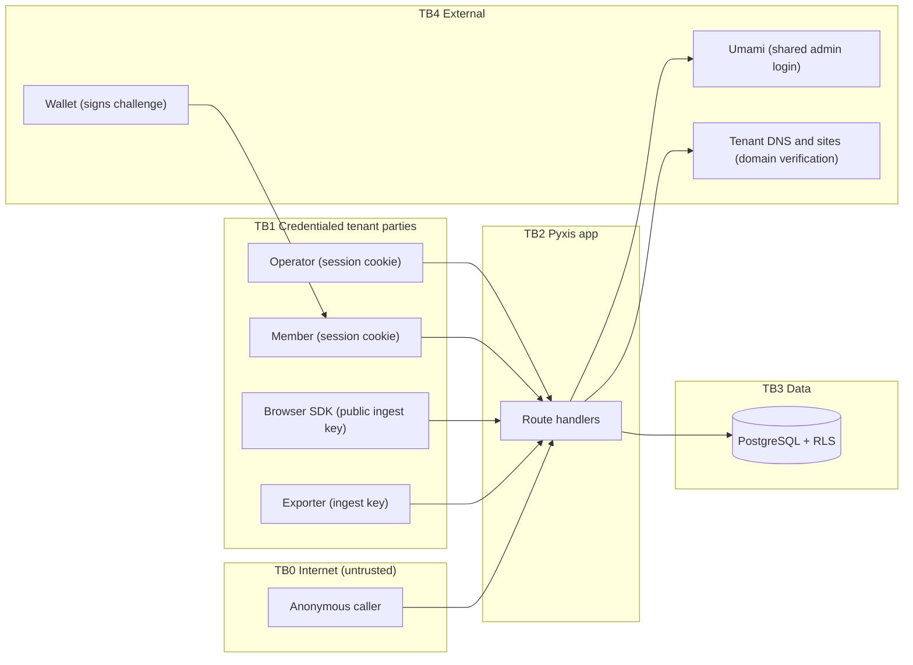

# Threat model (STRIDE)

**Status:** draft threat model for the SCF Build submission, based on the code at commit `a7df1da`. The RFP requires a threat model and monitoring plan in Tranche 2; this document is the **starting point, not that deliverable**. It has **not** been reviewed by an independent party and no independent security audit exists.
**Evidence basis:** a read-only source audit of authentication, authorization, RLS, keys and routes (no application code was run for that audit); the executed test suite ([02-test-and-verification-report.md](../02-test-and-verification-report.md)); `SECURITY.md`.
**Related:** [privacy-and-data-protection.md](privacy-and-data-protection.md), [../technical/architecture.md](../technical/architecture.md), [../FINAL-AUDIT-REPORT.md](../FINAL-AUDIT-REPORT.md).

## 1. Scope and assets

| Asset | Where | Why it matters |
|---|---|---|
| Tenant analytics aggregates | `endpoint_metric_buckets`, `wallet_event_buckets`, Umami | Confidentiality between tenants is the product's core promise |
| Ingest keys | `api_keys.secret_hash` | Write access to a tenant's data; integrity of metrics |
| Sessions | `sessions.token_hash` | Control of a tenant's project |
| Membership and roles | `project_members`, `users` | Who can read and change a project |
| Operator privilege | `OPERATOR_ACCOUNTS`, `users.is_operator` | Cross-tenant aggregate view and project suspension |
| Audit trail | `operator_audit_events`, `ingestion_audit` | Accountability |
| Availability | App, database | RFP commitments |

**Out of scope:** the security of tenants' own systems, of wallet software, of Umami's internals, and of Railway.

## 2. Data-flow diagram and trust boundaries

## 3. STRIDE by element

| # | Element | S: spoofing | T: tampering | R: repudiation | I: information disclosure | D: denial of service | E: elevation of privilege |
|---|---|---|---|---|---|---|---|
| 1 | Sign-in (`/auth/*`) | Challenge is single-use, 5 min, bound to account; signature verified server side. **Residual:** the message has no origin binding, so a hostile site can obtain a signature (SEC-06) | n/a | No sign-in audit log | Errors generic | **Unauthenticated challenge insert per request, no rate limit, rows never purged (SEC-01, SEC-10)** | Operator flag set at login from an environment list; stays set up to 7 days after removal (SEC-07) |
| 2 | Session cookie | 256-bit token, hash stored, HttpOnly, SameSite=Lax | **CSRF relies only on Lax; same-site subdomains (the docs site) are not blocked (SEC-02)** | Logout deletes the row | Cookie not readable by script | Session table unbounded | No re-authentication for sensitive actions |
| 3 | Ingest (`/v1/*`) | Key checked before body; constant-time compare; **error codes reveal key state (SEC-08)** | Tenant comes from the key, never the payload (test-backed); strict allowlists | `/v1/metrics` writes an audit row; **`/v1/wallet-events` writes none and does not update `last_used_at` (SEC-11)** | Responses reveal nothing about other tenants | **No rate limit; body buffered before size check; gzip unsupported (SEC-01, SEC-09)** | **Browser keys and server keys share one scope (SEC-04)** |
| 4 | Authorization (`authorize`) | n/a | Role rank check; 404 for non-members | Project-level admin actions (member add or remove, key create or revoke) are **not audited** | 404 hides existence | No quotas on projects, sites, members (SEC-13) | Loose UUID check can produce 500s, not escalation (SEC-12) |
| 5 | Row-level security | n/a | `FORCE RLS` and `WITH CHECK` on 8 tables; tests pass | Operator reads audited **except wallet funnel (SEC-03)** | Runtime role is not owner and not `BYPASSRLS` (test-backed); **`users`, `sessions`, `auth_challenges` have no RLS, so an injection would expose them** | Pool of 10, 15 s statement timeout | Operator context may select `api_keys.secret_hash` and write `projects` (SEC-14); definer functions use `search_path = public` (SEC-17) |
| 6 | Domain verification | Token 18 random bytes; DNS TXT or well-known file | Redirects refused; HTTPS only | n/a | Body never returned | **Unlimited outbound lookups per admin (SEC-13)** | **DNS rebinding between lookup and fetch; IPv6 and special ranges incomplete (SEC-05)** |
| 7 | Umami link | n/a | One shared admin credential; tenant isolation is an application lookup under RLS | n/a | A bug in the lookup would cross tenants (AN-09) | Umami outage degrades web view only | Shared credential is a high-value secret |
| 8 | Operator | Operator list is an environment variable | Status changes are audited | Audited except wallet read (SEC-03) | Aggregates only; no keys, members or sites | n/a | Operator can suspend any project |
| 9 | Deployment and supply chain | Dependabot, secret scanning | Lockfile; checksummed migrations | n/a | Default role password exists until `db:role` runs; code falls back to default credentials if the variable is unset (SEC-15) | Single replica (OPS-01) | **22 dependency advisories (10 high) in the wallet-kit and `shadcn` trees (SEC-18)**; no security headers or CSP (SEC-16) |

## 4. Specific attack scenarios

| Scenario | Outcome today | Evidence | Finding |
|---|---|---|---|
| Tenant B reads tenant A's analytics by guessing a project id | Blocked: 404; database also returns no rows | `tests/db.test.ts`, `scripts/e2e-smoke.mts` | none |
| Tenant context leaks through a reused pooled connection | Blocked | `tests/db.test.ts` "pooled connection does not leak" | none |
| Attacker floods `/api/v1/auth/challenge` | Succeeds; rows accumulate | `session.ts:20-26` | SEC-01, SEC-10 |
| Attacker floods `/v1/metrics` with well-formed random keys | One database lookup per request; no throttle | `keys.ts:31` | SEC-01 |
| Public browser key used to post fake API metrics | Succeeds (same scope) | `wallet-events/route.ts:17`, `metrics/route.ts:9` | SEC-04 |
| Attacker inflates the wallet funnel with a scraped browser key | Succeeds; documented as not proof of ledger activity | `wallet-events.ts` | accepted risk |
| Hostile site obtains a wallet signature for a Pyxis session | Possible if the victim signs | `session.ts:14-16` | SEC-06 |
| Sibling-subdomain page issues cookie-bearing mutations | Not blocked by Lax | `verify/route.ts:11` | SEC-02 |
| Operator reads a tenant's wallet funnel | Succeeds; **no audit row** | `wallet/route.ts` | SEC-03 |
| Domain with TTL-0 DNS points at an internal host | Possible in principle; impact limited to a status oracle on HTTPS port 443 | `domain.ts:40-42` | SEC-05 |
| SQL injection | None found; queries are parameterized; one hard-coded interpolation | `queries.ts:48` | none |
| XSS | No raw HTML sinks found; tracker snippet shown as text | `sites/page.tsx` | none |
| Secrets committed to git | None found across 26 commits (pattern scan) | audit | none |

## 5. Findings register (security)

Severity is the auditor's judgement. "Before launch" means before a public, multi-tenant launch.

| ID | Sev | Finding | Source | Before launch? | Remediation |
|---|---|---|---|---|---|
| SEC-01 | Medium | No rate limiting on any route; one DB query per unauthenticated key attempt | `keys.ts:31`, all routes | **Yes** | Per-IP and per-key limits; outstanding-challenge cap |
| SEC-02 | Medium | CSRF relies only on SameSite=Lax; no Origin check; docs subdomain is same-site | `verify/route.ts:11` | Recommended | Reject mutating requests with a foreign `Origin` or `Sec-Fetch-Site`; require JSON; `__Host-` cookie |
| SEC-03 | Medium | Operator read of the wallet funnel is not audited, contradicting the README and `SECURITY.md` | `projects/[id]/wallet/route.ts` | **Yes (small)** | Insert an audit row in the same transaction |
| SEC-04 | Medium | Browser SDK and server exporter share the `ingest` scope | `keys.ts:5` | Recommended | Add a browser scope accepted only by `/v1/wallet-events` |
| SEC-05 | Medium by pattern, Low in practice | SSRF guard resolves then fetches separately; `isPrivateIp` misses hex IPv4-mapped IPv6, NAT64, 6to4 and some IPv4 ranges; body buffered | `domain.ts:21-29,40-44` | Before mainnet | Pin the validated address; use a range library; stream at most 512 bytes; quota |
| SEC-06 | Low | Sign-in message has no origin or domain binding | `session.ts:14-16` | No | Put the Pyxis origin in the message |
| SEC-07 | Low | Operator flag stale up to 7 days after removal | `session.ts:38-41` | No | Evaluate the allowlist per request |
| SEC-08 | Low | Ingest `code` distinguishes unknown, bad secret, revoked, expired | `metrics/route.ts:10` | No | One external code; log the reason internally |
| SEC-09 | Low | Body bytes buffered before size check; counted in characters; gzip unsupported | `metrics/route.ts:15-18` | No | Streaming cap or proxy limit; decide gzip |
| SEC-10 | Low | `auth_challenges` and expired `sessions` never purged | `session.ts` | No | Scheduled purge |
| SEC-11 | Low | `/v1/wallet-events` does not update `last_used_at` or write `ingestion_audit` | `wallet-events/route.ts` | No | Mirror `/v1/metrics` |
| SEC-12 | Low | Loose UUID regex can yield 500 instead of 404 | `session.ts:70` | No | Strict UUID check |
| SEC-13 | Low | No quotas on projects, sites, members or keys | `projects/route.ts` | Recommended | Per-wallet and per-project quotas |
| SEC-14 | Low | Operator RLS policies broader than needed (`api_keys` select, `projects` write) | `001_init.sql:158,163` | No | Drop the key policy; status-only definer function |
| SEC-15 | Low | Default role password in migrations; code falls back to default credentials when `DATABASE_URL` is unset | `db.ts:9` | **Yes (config)** | Fail fast in production; verify rotation |
| SEC-16 | Info | No security headers or CSP | `next.config.ts` | Recommended | Add headers |
| SEC-17 | Info | Definer functions use `search_path = public` | `001_init.sql` | No | `pg_catalog` plus qualified names |
| SEC-18 | Medium (supply chain) | 22 production advisories (10 high), all via the wallet kit and `shadcn`; no upstream fix | `npm audit` | **Resolve or justify** | Isolate the wallet kit to the demo and sign-in page, replace or pin, move `shadcn` to dev |
| SEC-19 | Info | `analyst` has no distinct permissions; admins can modify other admins; no owner transfer | `session.ts:65` | No | Product decision |

## 6. What has been verified to hold

- No cross-tenant read or write path found in application code; every tenant-table query runs inside `withContext`.
- Runtime role is `NOSUPERUSER NOBYPASSRLS`, not the owner (asserted in `tests/db.test.ts`; **deployment not inspected**).
- Challenge consumption is one atomic statement; replay is rejected (manual script).
- Key and session secrets are 256-bit random values stored only as SHA-256.
- No raw-SQL string building from user input; no `dangerouslySetInnerHTML`.

## 7. Not verified

Real-wallet sign-in; the deployed database role, password rotation, network exposure and Postgres version; HTTPS and Secure-cookie behaviour on the live host; any proxy-level limits; DNS rebinding and IPv6 handling at runtime; Umami against a real release; cardinality abuse under load.

## 8. Monitoring plan (outline for Tranche 2)

The RFP requires a monitoring plan with the threat model. Proposed contents, all **PLANNED**: availability probes for ingest and dashboard; error-rate and latency alerts from Pyxis's own metrics; alerts on spikes in `ingestion_audit` rejections and on authentication failures; database size, connections and replication lag; alerts when a key's `last_used_at` is stale or when an operator action occurs; a review of dependency advisories within 24 hours of publication.
