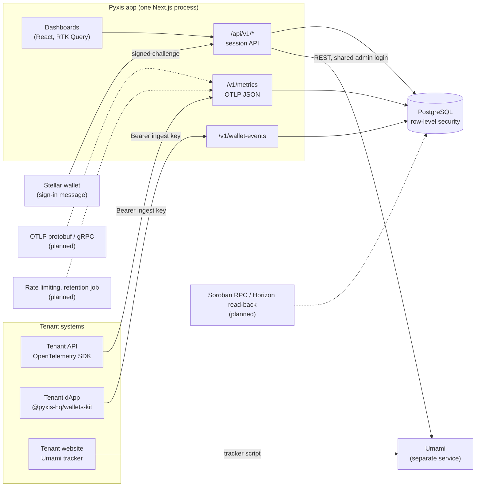
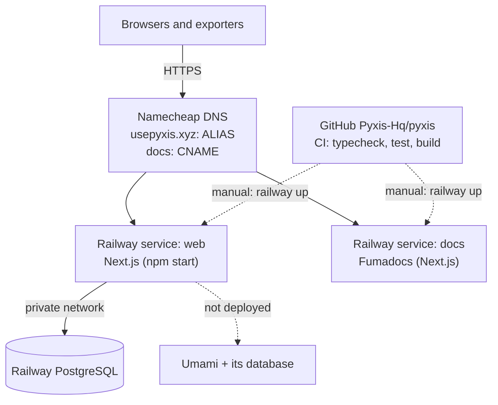
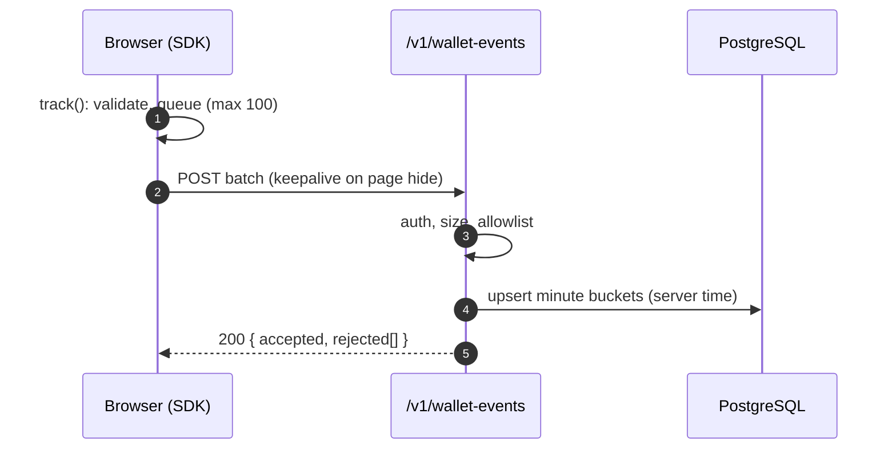
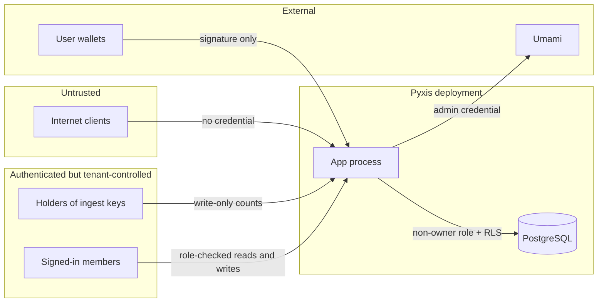

# System architecture

**Status:** describes the system at commit `a7df1da` and the live deployment of 2026-11-20. In every diagram, **solid lines are implemented** and **dashed lines or boxes marked "planned" do not exist yet**.
**Evidence basis:** `src/**`, `db/migrations/**`, `railway.json`, `docker-compose.yml`, `.github/workflows/ci.yml`, and HTTP checks of the live hosts on 2026-11-20 (`usepyxis.xyz` 200, `docs.usepyxis.xyz` 307 then 200).
**Related:** [technical-specification.md](technical-specification.md), [stellar-integration.md](stellar-integration.md), [../operations/infrastructure-and-operations.md](../operations/infrastructure-and-operations.md).

## 1. Component architecture



Status: the solid parts are IMPLEMENTED. The Umami link is IMPLEMENTED, NOT INDEPENDENTLY VERIFIED (tested against a fake server only). The three dashed boxes are PLANNED.

### Component responsibilities

| Component | Responsibility | Source |
|---|---|---|
| OTLP receiver | Authenticate the key, parse, validate, aggregate, persist | `src/app/v1/metrics/route.ts`, `src/server/ingest/otlp.ts` |
| Wallet-event receiver | Authenticate the key, allowlist, count | `src/app/v1/wallet-events/route.ts`, `src/server/wallet-events.ts` |
| Session API | Wallet sign-in, projects, members, keys, sites, analytics, operator | `src/app/api/v1/**` |
| Tenant context | One transaction per request with `app.project_id` set locally | `src/server/db.ts:20-37` |
| Query layer | Summaries, series, endpoint table | `src/server/queries.ts` |
| Umami client | Create website, read stats and metrics | `src/server/umami.ts` |
| Domain verifier | DNS TXT or well-known file, SSRF guard | `src/server/domain.ts` |
| Dashboards | Overview, endpoints, keys, sites, wallet funnel, settings, operator | `src/app/projects/**`, `src/components/pyxis/**` |

## 2. Deployment architecture (live, 2026-11-20)



Status: one replica per service, one PostgreSQL instance, **no standby, no monitoring, no alerting, no backup schedule evidenced in the repository**. Deployment is a manual CLI upload from a developer machine. Railway's own dashboard (domains, backups, variables) was **not** inspected by this audit.

| Property | Today |
|---|---|
| Replicas | 1 per service (Railway default; not set in the repository) |
| TLS | Terminated by Railway; certificates issued by Railway after DNS verification |
| Health check | `GET /` returns 200; it does **not** check the database |
| Migrations | Applied by hand over `railway ssh` after a deploy that adds one (the pre-deploy command in `railway.json` did not run on CLI deploys) |
| Secrets | Railway service variables |
| Portability | Any host with Node 22 and PostgreSQL works; no container image or infrastructure-as-code exists |

## 3. Data flow: API metrics

```mermaid
sequenceDiagram
  autonumber
  participant X as Exporter
  participant R as /v1/metrics
  participant K as keys.ts
  participant P as otlp.ts
  participant D as PostgreSQL
  X->>R: POST OTLP JSON, Bearer key
  R->>K: authenticateKey(header, "ingest")
  K->>D: pyxis_resolve_api_key(key_id) (SECURITY DEFINER)
  K-->>R: project id, or a 401/403 code
  R->>R: content type, size
  R->>P: parseOtlpMetrics (pure)
  P-->>R: aggregated rows, drop counts
  R->>D: BEGIN; set_config(app.project_id); upsert rows; audit row; last_used_at; COMMIT
  R-->>X: 200 (partialSuccess if any point dropped)
```

The response is sent after the commit. Status: IMPLEMENTED; unit-tested (`tests/unit.test.ts`) and tested on a real PostgreSQL (`tests/db.test.ts`); not load-tested.

## 4. Data flow: wallet funnel



Everything on the browser side of this diagram is **reported by the frontend**. No component reads the ledger.

## 5. Data flow: web analytics

```mermaid
sequenceDiagram
  autonumber
  participant A as Admin
  participant S as Pyxis API
  participant DNS as Tenant DNS / site
  participant U as Umami
  A->>S: add domain
  S-->>A: challenge token
  A->>DNS: publish TXT _pyxis.<domain> or /.well-known/pyxis.txt
  A->>S: verify
  S->>DNS: resolve TXT; else fetch well-known (no redirects, public IPs only)
  S->>U: create website (shared admin login)
  S-->>A: tracker snippet
  Note over U: Visitors send events to Umami, not to Pyxis
  A->>S: read report
  S->>U: stats and metrics
```

Status: IMPLEMENTED, NOT INDEPENDENTLY VERIFIED. All tenants share one Umami administrator login; isolation relies on the application looking up the Umami website id from the caller's own `sites` row.

## 6. Trust boundaries



| Boundary | Control | Weakness |
|---|---|---|
| Internet to app | Auth before body read on ingest | No rate limiting |
| App to database | Non-owner role, `FORCE ROW LEVEL SECURITY`, transaction-local tenant | Several tables (`users`, `sessions`, `auth_challenges`) have no RLS by design |
| App to Umami | One shared administrator credential | A bug in the site lookup would cross tenants |
| Browser keys | Write-only ingest scope | Public by nature; any holder can inflate counts |
