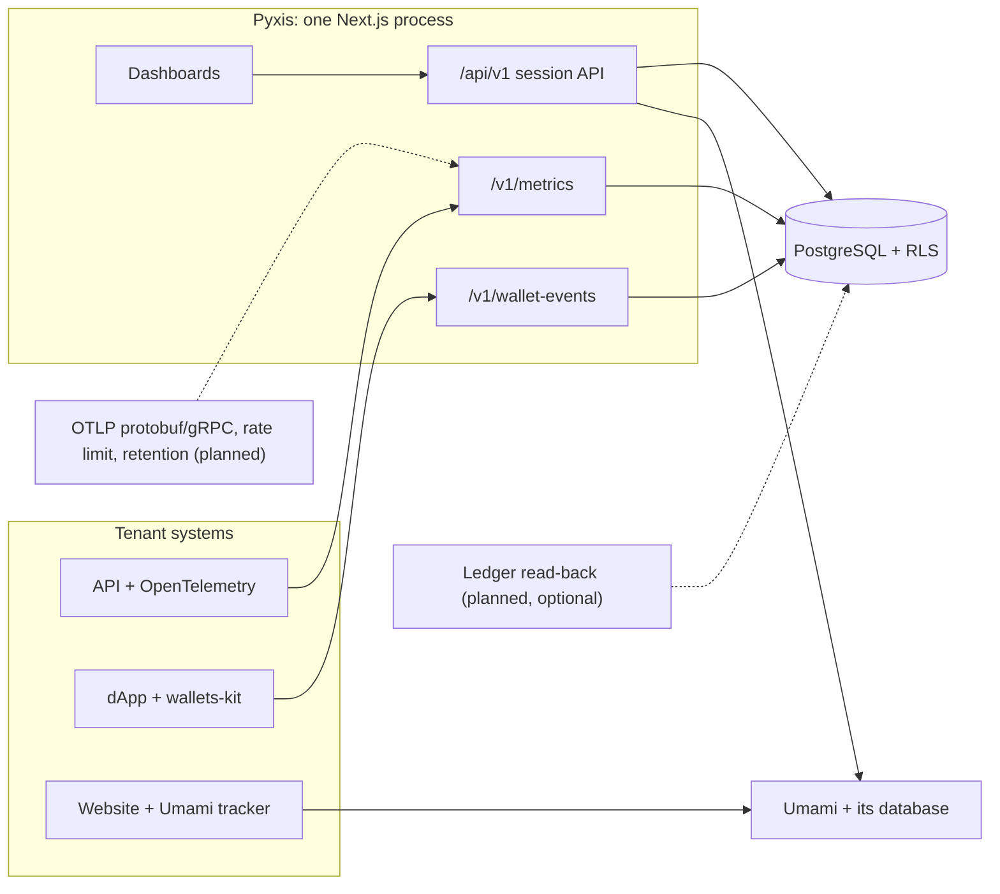
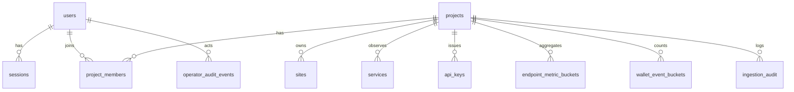

# Pyxis technical specification

**Status:** specification of Pyxis as implemented at commit `a7df1da` (2026-11-20), with planned work labelled as such. It was written after reading the source and executing the test suite (80 tests pass in a clean clone). It has **not** been reviewed by anyone independent of the authors, and **no independent security audit exists**.
**Evidence basis:** `src/server/**`, `src/app/**`, `db/migrations/001_init.sql`, `002_rename_to_pyxis.sql`, `sdk/wallets-kit/src/**`, `tests/**`, `scripts/**`, `railway.json`, `.github/workflows/ci.yml`, and the audit reports summarised in [../FINAL-AUDIT-REPORT.md](../FINAL-AUDIT-REPORT.md).
**Related:** [architecture.md](architecture.md), [stellar-integration.md](stellar-integration.md), [api-reference.md](api-reference.md), [telemetry-specification.md](telemetry-specification.md), [../security/threat-model.md](../security/threat-model.md), [../security/privacy-and-data-protection.md](../security/privacy-and-data-protection.md).

**Status vocabulary:** IMPLEMENTED · IMPLEMENTED, NIV (not independently verified) · PARTIAL · PLANNED · MISSING · BLOCKED. Citations are `path:line`; tests by file and title.

## 1. Executive technical summary

Pyxis is a multi-tenant analytics service for Stellar projects. One Next.js 16 process serves a dashboard, a session API and two key-authenticated ingest endpoints; PostgreSQL stores per-project aggregates behind forced row-level security; web analytics is delegated to a separate Umami instance. Three signals share one rule: **store aggregates, never individuals**.

What is solid: tenant isolation in the database (9 tests on a real PostgreSQL), the OTLP metrics pipeline (delta histograms, route templating, merged-histogram percentiles), the allowlisted wallet-event path and the published SDK. What is not: the web analytics path has never run against a real Umami; there is no rate limiting, retention job, load test, monitoring or backup evidence; protobuf OTLP, infrastructure-as-code and the SCF read API do not exist. **There is no Soroban or ledger integration.**

## 2. Scope and system boundaries

**In scope:** dashboards and APIs for web, API and wallet-funnel analytics; project, member and key management; domain verification; an operator view; the npm SDK; the documentation site.
**Out of scope today:** traces, logs, request bodies (rejected by design); on-chain analytics; billing; per-user analytics.
**Boundaries:** tenants' systems, Umami, wallets, Railway, DNS and the registrar are external.

## 3. Current implementation status

| Capability | Status | Evidence |
|---|---|---|
| Wallet sign-in and sessions | IMPLEMENTED; server side exercised manually; browser path NIV | `session.ts:14-63`; `scripts/e2e-smoke.mts` |
| Projects, members, roles | IMPLEMENTED | `src/app/api/v1/projects/**` |
| Ingest keys | IMPLEMENTED | `keys.ts`; `tests/db.test.ts` |
| Row-level security and tenant context | IMPLEMENTED | `001_init.sql:143-164`; `db.ts:20-37`; `tests/db.test.ts` |
| OTLP/HTTP JSON metrics | IMPLEMENTED | `otlp.ts`; `tests/unit.test.ts` |
| OTLP protobuf and gRPC | MISSING | `v1/metrics/route.ts:12-14` |
| Dashboards: API analytics | IMPLEMENTED | `queries.ts`; `src/app/projects/[id]` |
| Web analytics via Umami | IMPLEMENTED, NIV | `umami.ts`; `tests/web.test.ts` (fake only) |
| Domain verification | IMPLEMENTED; SSRF residual | `domain.ts`; `tests/web.test.ts` |
| Wallet funnel and SDK | IMPLEMENTED; frontend-reported | `wallet-events.ts`; `sdk/wallets-kit/src` |
| Operator view and audit | IMPLEMENTED; wallet read unaudited | `operator/overview/route.ts` |
| Rate limiting, retention, idempotency | MISSING | search |
| Read API for SCF | MISSING | `keys.ts:5` |
| Stellar read-back, Soroban | MISSING | [stellar-integration.md](stellar-integration.md) |
| IaC, container image, monitoring, backups | MISSING | [../operations/infrastructure-and-operations.md](../operations/infrastructure-and-operations.md) |

## 4. System architecture

Solid lines are implemented; dashed lines are planned. Deployment and data-flow diagrams are in [architecture.md](architecture.md).

## 5. Component responsibilities

See [architecture.md](architecture.md) section 1 and [../01-repository-inventory.md](../01-repository-inventory.md) sections 4-11.

## 6. Technology stack

Next.js 16.4.6, React 19.3.1, Tailwind 4.3.5, TypeScript ^5, PostgreSQL 17 or 18 with `pg` ^8.23.1, `@stellar/stellar-sdk` ^17.4.0, `zod` ^4.6.7, Vitest ^5.1.1, `tsup` ^8.5.1, Fumadocs 16.19.4. Node.js 22 (CI and production). Full table in [../01-repository-inventory.md](../01-repository-inventory.md) section 2.

## 7. Authentication architecture

| Step | Behaviour | Source |
|---|---|---|
| Challenge | 24 random bytes, 5-minute expiry, stored per account | `session.ts:20-26` |
| Message | `Pyxis sign-in (testnet)\naccount\nnonce\nexpires`; **no origin binding (SEC-06)** | `session.ts:14-16` |
| Signature | `sha256("Stellar Signed Message:\n" + message)` verified with the account's Ed25519 key | `session.ts:17-18,36` |
| Single use | One atomic `UPDATE ... SET used_at WHERE used_at IS NULL AND expires_at > now()` | `session.ts:30-34` |
| Session | 32 random bytes; SHA-256 stored; 7 days; HttpOnly, SameSite=Lax, `secure` in production | `session.ts:43-44`; `verify/route.ts:11` |
| Roles | viewer 1, analyst 2, developer 3, admin 4, owner 5; operator is a separate user flag | `session.ts:65-76` |
| Operator | `OPERATOR_ACCOUNTS` list applied at sign-in | `session.ts:11,38` |

Not present: rate limiting, CSRF token or origin check (SEC-01, SEC-02), re-authentication, "revoke all sessions", expiry purge.

## 8. Multi-tenant architecture

A tenant is a **project**. Tenant context is a transaction-local setting `app.project_id` set by `withContext` (`db.ts:20-37`); policies compare each row's `project_id` with `pyxis_tenant()`. Credentials, not payloads, decide the tenant: the ingest key resolves the project (`keys.ts:24-42`) and `parseOtlpMetrics` never reads a tenant from the body (`otlp.ts:52`; `tests/unit.test.ts` "ignores tenant attributes in payload"). Operators use a separate context flag that grants read-only access to metric tables and to `projects`.

## 9. Database architecture

### 9.1 Tables

| Table | RLS | Purpose |
|---|---|---|
| `users` | no | Stellar account, operator flag |
| `auth_challenges` | no | Sign-in nonces |
| `sessions` | no | Hashed session tokens |
| `projects` | forced; `projects_tenant` | Tenants; status `pending`, `active`, `suspended`, `archived` |
| `project_members` | forced; `tenant_all` | Role per user per project |
| `sites` | forced | Domain, verification token and status, Umami website id |
| `services` | forced | Observed (service, environment) pairs, capped at 10 per project |
| `api_keys` | forced; `operator_read` | Key id, secret hash, scopes, expiry, revocation, last use |
| `endpoint_metric_buckets` | forced; `operator_read` | 60-second API aggregates |
| `wallet_event_buckets` | forced; `operator_read` | 60-second wallet event counts |
| `ingestion_audit` | forced; `operator_read` | One row per metrics request |
| `operator_audit_events` | no (application has `SELECT, INSERT` only) | Operator actions |

### 9.2 Relationships

### 9.3 Keys, indexes, constraints

Primary key of `endpoint_metric_buckets`: `(project_id, bucket_start, bucket_seconds, service_name, environment, http_method, normalized_route, status_code)`; the upsert in `otlp.ts:147-155` relies on it. Check constraints: `histogram_counts` length 12, counts non-negative, status 100-599, `users.stellar_account` matches `^G[A-Z2-7]{55}$`, role and status enums. Indexes: `project_members_user_idx`, `endpoint_metrics_project_time_idx (project_id, bucket_start DESC)`, `ingestion_audit_project_time_idx`. There is **no index on `wallet_event_buckets` beyond its primary key**.

### 9.4 Functions and roles

Five `SECURITY DEFINER` functions (`pyxis_resolve_api_key`, `pyxis_user_projects`, `pyxis_user_role`, `pyxis_create_project`, `pyxis_operator_projects`, all `SET search_path = public`) serve lookups that happen before a tenant is known. Three invoker helpers: `pyxis_add_arrays`, `pyxis_tenant`, `pyxis_is_operator`. The runtime role `pyxis_app` is `LOGIN NOSUPERUSER NOBYPASSRLS NOCREATEDB NOCREATEROLE` (`001_init.sql:6`). Migration `002` renamed the role and eight functions after the product was renamed; `001` is frozen and still says "Stellar Pulse" in its header.

### 9.5 Migrations

`scripts/migrate.ts` applies `db/migrations/*.sql` in filename order, each in a transaction, recording a SHA-256 of the file with line endings normalized. A changed applied file aborts the run.

### 9.6 Retention, deletion, recovery

No retention job exists (AN-01); aggregates and audit rows are kept indefinitely. Deleting a project cascades, but no endpoint deletes one. Backups and restores are not evidenced ([../operations/infrastructure-and-operations.md](../operations/infrastructure-and-operations.md) section 5).

## 10. API analytics ingestion

Full rules and limits in [telemetry-specification.md](telemetry-specification.md). Pipeline: authenticate key, check content type and size, parse (pure), enforce limits, then one transaction: set tenant, upsert aggregates, write an `ingestion_audit` row, update `last_used_at`, commit, respond. JSON only; delta histograms only; one `ingestion_audit` row per request.

## 11. Web analytics and Umami

The Pyxis client calls Umami's REST API (`POST /api/auth/login`, `POST /api/websites`, `GET /api/websites/:id/stats`, `/metrics`) with one shared administrator login (`umami.ts`). Tenant isolation depends on the application reading the Umami website id from the caller's own `sites` row (`sites/[siteId]/web/route.ts`). The tracker snippet loads `script.js` from the operated Umami. **Not run against a real Umami; the tracker is not version-pinned; the compose file uses a mutable tag** (AN-09).

## 12. Wallet analytics SDK

`@pyxis-hq/wallets-kit@0.1.0-beta.1`. Core `PyxisWallet` and `createPyxisWallet`; React `PyxisProvider`, `usePyxis`. Behaviour: nine events, nine provider labels, queue of 100 (drop oldest), batches of up to 50, flush every 5 s and on page hide with `keepalive`, retry with backoff and jitter up to 5 times, batch split on `413`, circuit breaker after three consecutive `401` or `403`, Do Not Track and Global Privacy Control honoured, nothing stored in cookies or storage (`sdk/wallets-kit/src/index.ts`). **Not built:** Wallets Kit adapter, automatic capture, OpenTelemetry helper. Known limits: `failure_category` is a pattern, not a list (SDK-01); tests run against source (SDK-02); no publishing provenance (SDK-03).

## 13. Stellar integration

See [stellar-integration.md](stellar-integration.md). Summary: signature verification of the sign-in message, key validation, a Testnet demo payment, and a client-declared network label. No Soroban, RPC, Horizon read-back or on-chain verification.

## 14. Soroban integration status and roadmap

MISSING; optional extension E-1 to E-3 in [../planning/roadmap-and-milestones.md](../planning/roadmap-and-milestones.md). The web and API analytics RFP does not require it.

## 15. API contracts

[api-reference.md](api-reference.md). Two surfaces: 17 session routes and 4 ingest routes. Errors use `{ code, message }`. No pagination, no rate limits, no versioning policy.

## 16. Data models

Section 9 and the ER diagram above. Aggregate row shape: `(project, bucket_start, service, environment, method, route, status, request_count, duration_sum_ms, histogram_counts[12])`. Wallet row: `(project, bucket_start, event, provider_category, network, event_count)`.

## 17. Event schemas

[telemetry-specification.md](telemetry-specification.md) sections 3 and 4.

## 18. Metric definitions and calculation

Requests, status classes, server error rate (5xx over all), success rate ((2xx + 3xx) over all), average, and p50, p95, p99 interpolated from **merged** 12-bucket histograms; any percentile above 10 s reports 10,000 ms; empty unit is read as milliseconds. [telemetry-specification.md](telemetry-specification.md) section 3.5.

## 19. Data flows

[architecture.md](architecture.md) sections 3-5 (sequence diagrams for metrics, wallet events and web analytics).

## 20. Trust boundaries

[architecture.md](architecture.md) section 6 and [../security/threat-model.md](../security/threat-model.md) section 2.

## 21. Privacy model

[../security/privacy-and-data-protection.md](../security/privacy-and-data-protection.md). No compliance claim; GDPR, residency and erasure are not implemented.

## 22. Security architecture

Controls that hold (verified): forced RLS with a non-owner role, transaction-local tenant context, hashed secrets, constant-time key comparison, authentication before body read on ingest, 404 for unauthorised project access, parameterized SQL. Gaps: SEC-01 to SEC-19 in [../security/threat-model.md](../security/threat-model.md) section 5.

## 23. Infrastructure and deployment

One replica per service on Railway in `us-west2`, one PostgreSQL instance, manual CLI deployment, no container image, no IaC. [../operations/infrastructure-and-operations.md](../operations/infrastructure-and-operations.md).

## 24. Scalability and performance

**No benchmark exists.** Design features that help: 60-second pre-aggregation, delta histograms, cardinality caps. Observed weaknesses: per-row sequential upserts and a `SELECT DISTINCT` over seven days on every batch (`otlp.ts:127-131`), a hot-row `last_used_at` update, and dashboard queries that read raw rows into Node for up to 90 days (`queries.ts:37-77`). The one-million-requests-per-day figure is an RFP design target, about 11.6 requests per second on average, and is **unproven** here (AN-05).

## 25. Failure handling

| Failure | Behaviour |
|---|---|
| Database down | Sign-in returns `503 service_unavailable`; ingest returns a framework 500 (not verified at runtime) |
| Umami down | Verification returns `tracker_ready: false`; report returns `502 engine_unavailable` |
| Bad ingest data | Dropped with reason codes in `partialSuccess` |
| Process crash | Railway restarts it (`ON_FAILURE`) |
| Retried batch | Counted twice (AN-02) |

## 26. Monitoring and observability

None beyond console output and the two audit tables. A plan is a Tranche 2 deliverable ([../security/threat-model.md](../security/threat-model.md) section 8).

## 27. Backup and recovery

Not evidenced; `pg_dump` is described in the public guide and not exercised.

## 28. Licensing and open-source strategy

Apache-2.0 for the application and the SDK; public repository; contributions under the same licence (`CONTRIBUTING.md`). The wallet kit dependency tree carries advisories with no fix (SEC-18). Governance gaps in [../planning/maintenance-and-governance.md](../planning/maintenance-and-governance.md).

## 29. Known limitations

OTLP JSON only; no rate limiting; no retention; no idempotency; no service or environment filter; web path unverified; no real-wallet evidence; no Soroban; single replica; wallet funnel is frontend-reported; one shared Umami credential; `analyst` role has no distinct permissions; no project deletion or ownership transfer.

## 30. Technical risks

| Risk | Impact | Mitigation proposed |
|---|---|---|
| Umami's API or metrics differ from assumptions | Web path wrong | T1-1 integration suite against a real, pinned Umami |
| Ingest unproven at volume | Missed RFP target | T1-3, T2-6 |
| Availability target unreachable | Evaluation penalty | State an honest SLO; decide architecture before budgeting |
| Wallet-kit advisories | Client-side supply-chain exposure; 24-hour patch commitment at risk | Isolate and replace (SEC-18) |
| Adoption depends on third parties | Adoption proof late | Start pilots in Tranche 1 |
| Single-maintainer bus factor | Continuity | Governance deliverables |

## 31. Verification and acceptance evidence

Executed: typecheck, 80 tests, three builds, `npm audit` ([../02-test-and-verification-report.md](../02-test-and-verification-report.md)). Planned acceptance tests: [../planning/acceptance-test-plan.md](../planning/acceptance-test-plan.md). Not verified: real wallet, real Umami, load, availability, deployed database role.

## 32. Requirement-to-code traceability

| RFP row | Source | Test | Result |
|---|---|---|---|
| G1 isolation | `001_init.sql:143-164`, `db.ts` | `tests/db.test.ts` | Pass |
| A2 metrics only | `v1/traces`, `v1/logs`, `otlp.ts` | `tests/unit.test.ts`; smoke (manual) | Pass |
| A3 attributes | `otlp.ts:52-113` | `tests/unit.test.ts` | Pass |
| A4 normalization | `normalize.ts` | `tests/unit.test.ts` | Pass |
| A8 percentiles | `queries.ts`, `histogram.ts` | `tests/unit.test.ts` (loose) | Pass |
| W6 web metrics | `umami.ts` | `tests/web.test.ts` (fake) | Pass against a fake |
| W-wallet allowlist | `wallet-events.ts` | `tests/wallet.test.ts` | Pass |
| SDK behaviour | `sdk/wallets-kit/src` | `tests/sdk.test.ts` | Pass |
| Sign-in | `session.ts` | none in CI | Gap |
| Every route | `src/app/**/route.ts` | none | Gap |

## 33. References

Matrix: [../03-rfp-requirements-matrix.md](../03-rfp-requirements-matrix.md). Gaps: [../04-rfp-gap-analysis.md](../04-rfp-gap-analysis.md). Evidence index: [../EVIDENCE-REGISTER.md](../EVIDENCE-REGISTER.md). Public documentation: <https://docs.usepyxis.xyz>. Repository: <https://github.com/Pyxis-Hq/pyxis>. npm: <https://www.npmjs.com/package/@pyxis-hq/wallets-kit>.
